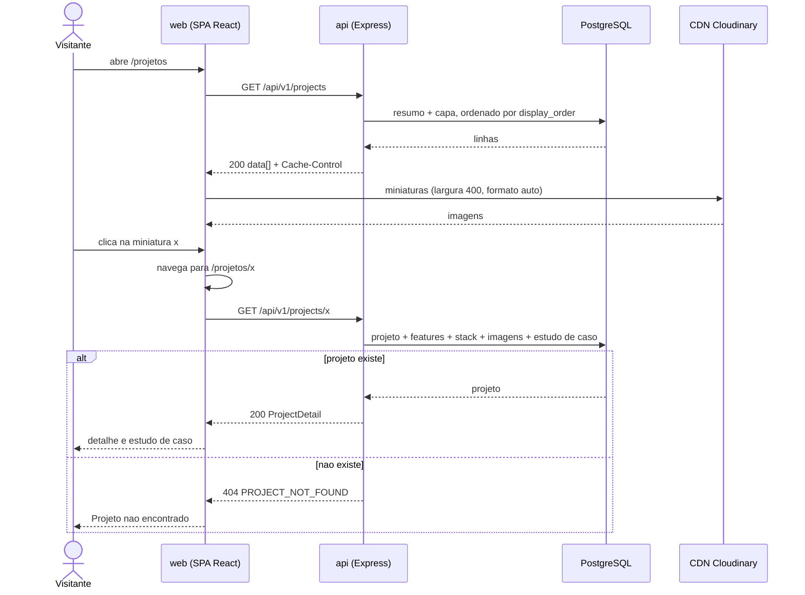
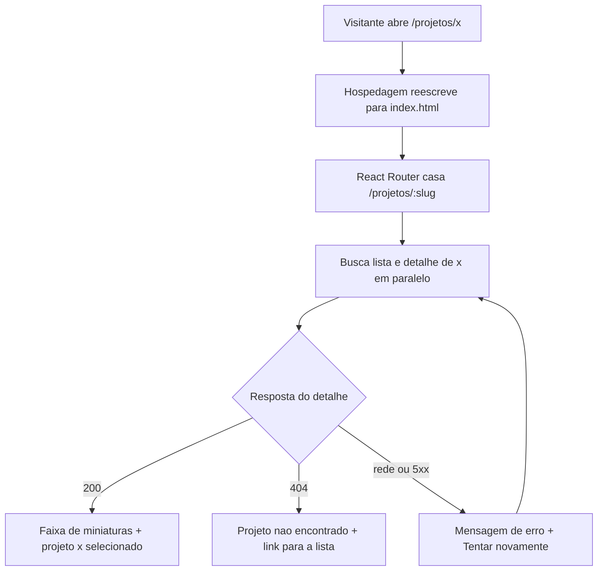
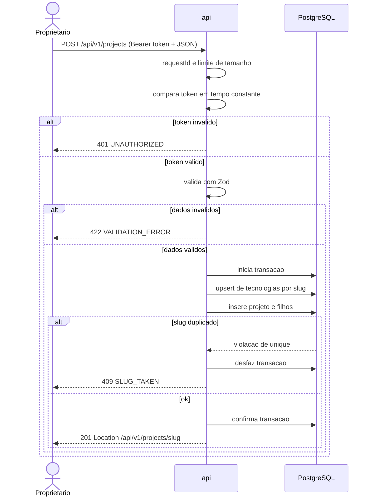
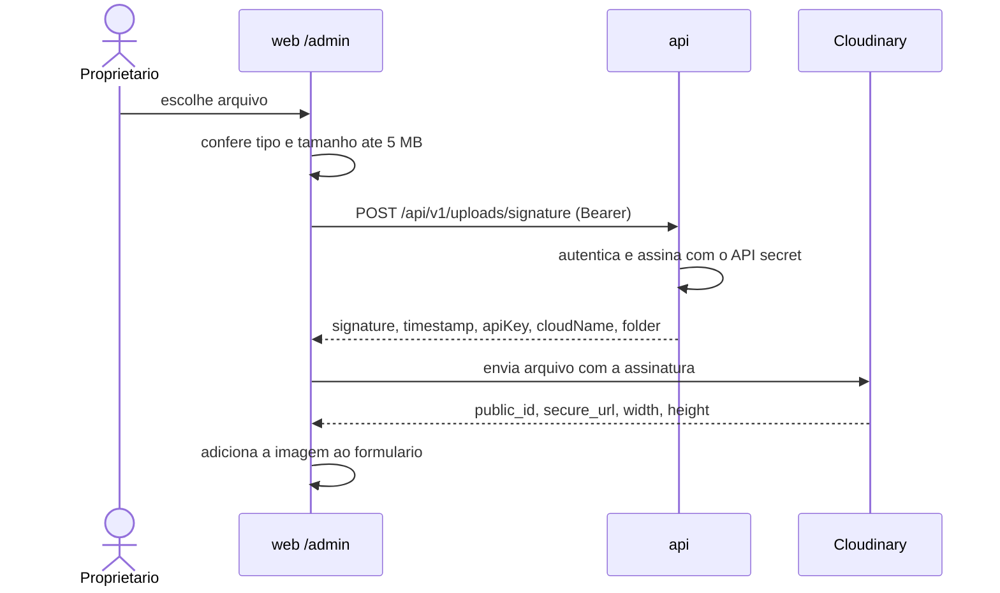
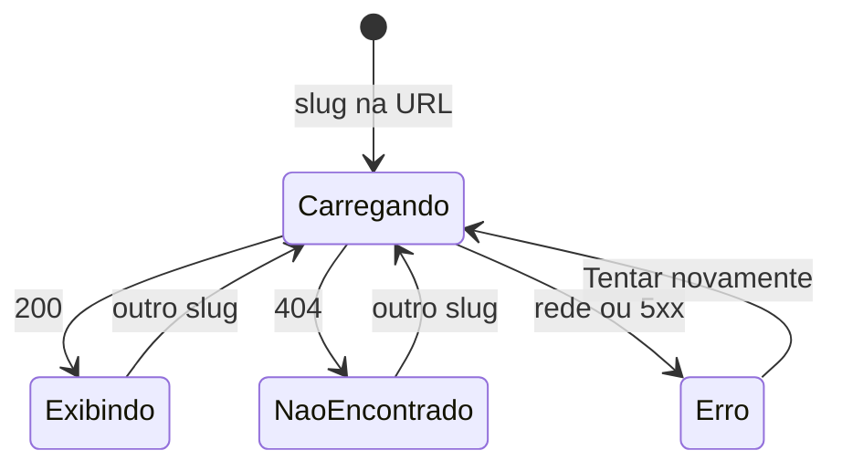
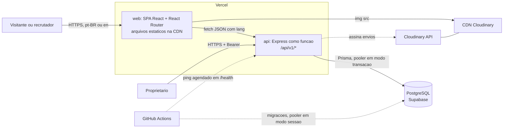
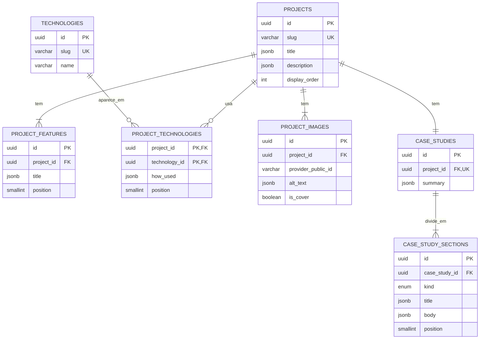
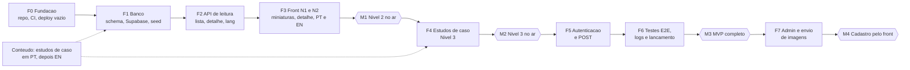

# Especificação Técnica — Projeto 09: Portfólio com Estudos de Caso

Oct 19, 2026 · @Marcos RIbeiro Junior

## Como ler este documento

Esta especificação transforma as 7 páginas do PDF do Projeto 09 (Portfólio Boost Program, nível básico, full-stack) em requisitos rastreáveis. Cada afirmação traz a sua origem.

| Marca | Significado |
| --- | --- |
| **\[PDF\]** | Está escrito no documento (página indicada) |
| **\[INFERÊNCIA\]** | Conclusão lógica tirada do que está no PDF |
| **\[PROPOSTA\]** | Decisão técnica sugerida nesta especificação, não está no PDF |
| **\[PENDÊNCIA\]** | Precisa ser decidido por você; cada uma tem um código D-xx na seção 21 |

Páginas do PDF, pela numeração impressa: capa · 01 Wireframe · 02 Projeto, Tech stack, Libraries, Briefing · 03 Níveis 1, 2 e 3 · 04 Requisitos de back-end · 05 Back-end (cont.) e front-end · 06 Front-end (cont.) e desacoplamento.

### Inventário de requisitos do PDF

Todo o resto do documento aponta para estes IDs. Nada aqui foi acrescentado: é o PDF parafraseado, linha a linha.

| ID | Página | O que o PDF pede |
| --- | --- | --- |
| PDF-01 | 02 | Criar uma lista de projetos que inclua estudos de caso e detalhes sobre cada projeto |
| PDF-02 | 01 | Wireframe: faixa superior com a lista de projetos em miniatura (thumb); abaixo, nome do projeto, descrição, feature 1 a 3, três linhas “stack de tecnologia e como foi feito” e um bloco de imagem |
| PDF-03 | 03 | Nível 1: uma página com a lista de alguns dos melhores projetos |
| PDF-04 | 03 | Nível 2: imagens e detalhes para cada projeto |
| PDF-05 | 03 | Nível 3: estudo de caso para cada projeto, detalhando processo, decisões e desafios |
| PDF-06 | 02 | Stack: React, Node.js, Prisma, BaaS (o PDF escreve “Back-as-a-service”), noções de serverless; biblioteca React Router |
| PDF-07 | 04 | Schema de banco em PostgreSQL com tabelas para títulos, descrições, imagens, estudos de caso e outros metadados |
| PDF-08 | 04 | Banco hospedado na cloud via plataforma serverless: Railway ou Vercel |
| PDF-09 | 05 | Prisma como ORM, integrado ao BaaS |
| PDF-10 | 05 | API REST (por exemplo, Express) expondo os dados ao front-end |
| PDF-11 | 05 | API com métodos para listar projetos, buscar um projeto específico e adicionar um novo |
| PDF-12 | 05 | Front-end consome a API para listar, buscar um e adicionar um novo projeto |
| PDF-13 | 05 | Componente React de lista que busca da API e exibe os projetos |
| PDF-14 | 05 | Dica: buscar a lista quando o componente renderiza, com hooks (useState); avaliar useCallback conforme o tamanho da lista |
| PDF-15 | 06 | Componente React de detalhes que busca da API e mostra título, descrição, imagens e estudos de caso |
| PDF-16 | 06 | Imagens armazenadas e servidas por serviço de terceiros (Cloudinary ou Filestack) |
| PDF-17 | 06 | Componente React de estudos de caso que busca da API |
| PDF-18 | 06 | Front e back dissociados, em pastas semânticas: web (front) e api (back) |
| PDF-19 | 02–03 | Briefing: mostrar o trabalho para que outros entendam como você pensa; ajuda candidatos a emprego a se destacarem |

O PDF não fala de autenticação, edição, exclusão, idioma, SEO nem responsividade. Esses pontos aparecem adiante como \[INFERÊNCIA\] ou \[PENDÊNCIA\], nunca como requisito do PDF.

## 1. Visão geral

O Projeto 09 é um portfólio web full-stack: uma página que lista seus melhores projetos e, para cada um, mostra detalhes, imagens e um estudo de caso sobre como você pensou e decidiu. \[PDF-01, PDF-03 a PDF-05, PDF-19\]

- **O que é:** uma aplicação React (pasta `web`) que consome uma API REST em Node.js/Express (pasta `api`). Os dados ficam em PostgreSQL gerenciado no Supabase, acessado via Prisma, e as imagens ficam num serviço de terceiros (Cloudinary). \[PDF-06 a PDF-10, PDF-16, PDF-18\]
- **Para quem:** recrutadores e possíveis colaboradores que querem entender que tipo de projeto você faz e como você pensa. \[PDF-19\]
- **Quem alimenta:** você, dono do portfólio, cadastrando projetos pela API. O PDF pede o método “adicionar um novo projeto”, mas não diz quem pode usá-lo. \[PDF-11\] \[D-01: token de administrador\]
- **Nível:** básico, full-stack, com três níveis progressivos de entrega (lista → detalhes e imagens → estudos de caso). \[PDF capa, PDF-03 a PDF-05\]

### Solução proposta em uma frase

Uma SPA React com React Router mostra a faixa de miniaturas e o detalhe do projeto selecionado na mesma tela, com URL própria por projeto (`/projetos/:slug`); interface e conteúdo existem em português e inglês (D-12); a API Express expõe 3 operações (listar, detalhar, criar) sobre um PostgreSQL no Supabase com 7 tabelas. \[PROPOSTA\]

Um detalhe que muda o padrão de qualidade: como é um portfólio, o próprio código-fonte também será lido por recrutadores. Organização, README e testes fazem parte do produto. \[INFERÊNCIA a partir de PDF-19\]

## 2. Objetivos

O projeto está pronto quando cumpre os três níveis do PDF sobre uma base técnica que você consiga explicar numa entrevista.

| ID | Objetivo | Origem | Como saber que foi atingido |
| --- | --- | --- | --- |
| OBJ-01 | Página com a lista dos seus melhores projetos | \[PDF-03\] Nível 1 | Lista publicada numa URL pública |
| OBJ-02 | Cada projeto com detalhes e imagens | \[PDF-04\] Nível 2 | Todo projeto exibe descrição, features, stack e pelo menos 1 imagem |
| OBJ-03 | Cada projeto com estudo de caso sobre processo, decisões e desafios | \[PDF-05\] Nível 3 | Todo projeto publicado tem estudo de caso com, no mínimo, processo e desafios |
| OBJ-04 | Praticar full-stack desacoplado: React, API REST em Node, Prisma, Postgres na cloud e imagens em serviço externo | \[PDF-06 a PDF-18\] | `web` e `api` rodam e fazem deploy de forma independente |
| OBJ-05 | Ajudar você a se destacar como candidato | \[PDF-19\] | Você consegue mandar a um recrutador o link de um projeto específico \[INFERÊNCIA\] |

Os critérios da última coluna são \[PROPOSTA\]: o PDF define o que entregar, não como medir.

## 3. Escopo

O escopo é um catálogo público de projetos com um único fluxo de escrita (criar projeto), organizado em 7 módulos.

| Módulo | Funcionalidades | Origem | Requisitos |
| --- | --- | --- | --- |
| M1 Catálogo público | Faixa de miniaturas; seleção e detalhe do projeto; features; stack e “como foi feito”; imagens; URL própria por projeto | \[PDF-01 a PDF-04, PDF-13, PDF-15\] | RF-01 a RF-05, RF-07 |
| M2 Estudos de caso | Estudo de caso por projeto com processo, decisões e desafios | \[PDF-05, PDF-17\] | RF-06 |
| M3 API de projetos | Listar, detalhar e criar projeto | \[PDF-10, PDF-11\] | RF-08 a RF-10 |
| M4 Mídia | Armazenar e servir imagens no Cloudinary; envio de imagens | \[PDF-16\] | RF-11, RF-14 |
| M5 Administração | Proteger a criação; formulário de cadastro no front | \[PDF-11, PDF-12\] \[D-01, D-08\] | RF-12, RF-13 |
| M6 Plataforma | Banco gerenciado no Supabase, deploy serverless, logs, testes, CI | \[PDF-06 a PDF-09, PDF-18\] \[D-02\] | RNF-01 a RNF-12 |
| M7 Idiomas | Interface e conteúdo em português e inglês; seletor de idioma | \[D-12\] | RF-15, RNF-13 |

### Dentro do escopo

- Os três níveis do PDF: lista, detalhes com imagens e estudos de caso. \[PDF-03 a PDF-05\]
- Os três métodos da API que o PDF nomeia: listar, buscar um, adicionar. \[PDF-11\]
- Proteção da escrita, porque sem ela qualquer pessoa poderia publicar no seu portfólio. \[INFERÊNCIA\]

Por decisão sua, também está dentro do escopo: interface e conteúdo completos em português e inglês desde o MVP. \[D-12\]

### Fora do escopo (o PDF não pede)

Editar e excluir projetos, múltiplos usuários, comentários, busca e filtros, blog, analytics, um terceiro idioma e renderização no servidor (SSR). Cada item pode virar evolução futura (seção 19); editar e excluir dependem de D-09.

### Depende de decisão

Só o formato de armazenamento dos textos nos dois idiomas (D-19). As demais decisões que afetavam o escopo foram tomadas em 19/10/2026 (seção 21).

## 4. Requisitos funcionais

São 15 requisitos: 12 vêm do PDF, 2 são inferências necessárias para que os do PDF possam ser compartilhados e funcionem com segurança (RF-07, RF-12) e 1 vem da sua decisão por um portfólio bilíngue (RF-15).

| ID | Requisito | Origem | Prioridade |
| --- | --- | --- | --- |
| RF-01 | Listar projetos em miniatura | \[PDF-01, 02, 03, 13\] | MVP |
| RF-02 | Selecionar projeto e ver nome e descrição | \[PDF-02, 04, 15\] | MVP |
| RF-03 | Exibir features do projeto | \[PDF-02\] | MVP |
| RF-04 | Exibir stack e “como foi feito” | \[PDF-02\] | MVP |
| RF-05 | Exibir imagens do projeto | \[PDF-02, 04, 15, 16\] | MVP |
| RF-06 | Exibir estudo de caso | \[PDF-05, 15, 17\] | MVP |
| RF-07 | Abrir projeto por URL própria | \[INFERÊNCIA de PDF-06 e PDF-19\] | MVP |
| RF-08 | API: listar projetos | \[PDF-11\] | MVP |
| RF-09 | API: obter um projeto | \[PDF-11\] | MVP |
| RF-10 | API: criar projeto | \[PDF-11\] | MVP |
| RF-11 | Armazenar e servir imagens no Cloudinary | \[PDF-16\] | MVP |
| RF-12 | Autenticar o proprietário para escrita | \[INFERÊNCIA\] \[D-01\] | MVP |
| RF-13 | Formulário de cadastro no front | \[PDF-12\] \[D-08\] | Depois do MVP |
| RF-14 | Envio de imagens pelo front | \[PDF-16\] \[D-06\] | Depois do MVP |
| RF-15 | Conteúdo e interface em português e inglês | \[D-12\] | MVP |

Cada requisito abaixo segue: objetivo → entrada → processamento → saída → regras → validações → permissões → critérios de aceite (CA).

### RF-01 — Listar projetos em miniatura

- **Objetivo:** mostrar de relance quais projetos existem. \[PDF-02, PDF-03\]
- **Entrada:** nenhuma ação do visitante; dados de `GET /api/v1/projects`.
- **Processamento:** o componente de lista busca os dados ao montar e guarda em estado. \[PDF-13, PDF-14\]
- **Saída:** faixa de miniaturas com imagem de capa e título. \[PROPOSTA sobre o conteúdo da miniatura, D-11\]
- **Regras:** RN-05 (capa), RN-08 (ordem).
- **Validações:** se faltar capa, mostrar imagem neutra com o título.
- **Permissões:** qualquer visitante.
- **CA-01a:** dado que há 3 projetos, quando abro `/projetos`, então vejo 3 miniaturas na ordem de `displayOrder`.
- **CA-01b:** dado que não há projetos, então vejo uma mensagem de lista vazia, não um erro.
- **CA-01c:** enquanto a lista carrega, vejo placeholders (skeletons) no lugar das miniaturas, e a busca acontece uma vez por montagem.
- **CA-01d:** dado que a API falha, então vejo mensagem de erro e um botão “Tentar novamente” que refaz a busca.

### RF-02 — Selecionar projeto e ver nome e descrição

- **Objetivo:** entender um projeto específico. \[PDF-02, PDF-04, PDF-15\]
- **Entrada:** clique numa miniatura, ou o slug na URL.
- **Processamento:** navega para `/projetos/:slug`; o componente de detalhe busca `GET /api/v1/projects/:slug` e cancela a busca anterior se o visitante trocar rápido de projeto. \[PROPOSTA\]
- **Saída:** nome do projeto e descrição, seguidos das seções de RF-03 a RF-06, abaixo da faixa de miniaturas (como no wireframe). \[PDF-02\]
- **Regras:** RN-01, RN-02.
- **Validações:** slug inexistente → a API responde 404 → a tela mostra “Projeto não encontrado” com link para a lista.
- **Permissões:** qualquer visitante.
- **CA-02a:** dado a lista carregada, quando clico na miniatura “X”, então a URL muda para `/projetos/x`, o detalhe de X aparece e a faixa de miniaturas continua visível.
- **CA-02b:** a miniatura selecionada fica destacada e marcada com `aria-current`.
- **CA-02c:** ao abrir `/projetos` sem slug, o primeiro projeto da ordem aparece selecionado. \[D-03\]

### RF-03 — Exibir features do projeto

- **Objetivo:** mostrar o que o projeto faz. \[PDF-02\]
- **Entrada:** lista de features que vem no detalhe do projeto.
- **Processamento:** ordenar por `position`.
- **Saída:** lista de features com título e, se houver, descrição curta.
- **Regras:** RN-03 (quantidade, D-05).
- **Validações:** na criação, título da feature com 1 a 120 caracteres. \[PROPOSTA\]
- **Permissões:** leitura por qualquer visitante.
- **CA-03a:** dado um projeto com 3 features, então as 3 aparecem na ordem em que foram cadastradas.

### RF-04 — Exibir stack e “como foi feito”

- **Objetivo:** mostrar quais tecnologias foram usadas e como cada uma foi aplicada. \[PDF-02\]
- **Entrada:** itens de stack do projeto (tecnologia + texto).
- **Processamento:** ordenar por `position`.
- **Saída:** linhas “Tecnologia — como foi usada”, ao lado do bloco de imagem, como no wireframe. \[PDF-02\]
- **Regras:** RN-04, RN-12.
- **Validações:** tecnologia e texto obrigatórios, porque o wireframe junta os dois na mesma linha. \[INFERÊNCIA\]
- **Permissões:** leitura por qualquer visitante.
- **CA-04a:** dado o item React com o texto “SPA com rotas por projeto”, então aparecem “React” e esse texto na mesma linha.

### RF-05 — Exibir imagens do projeto

- **Objetivo:** dar contexto visual ao projeto. \[PDF-04\]
- **Entrada:** imagens do projeto (URL, `publicId`, texto alternativo, capa).
- **Processamento:** montar a URL do Cloudinary com o tamanho certo: menor na miniatura, maior no detalhe. \[PROPOSTA\]
- **Saída:** a capa no bloco “Imagem” do wireframe; as demais numa galeria simples, se houver. \[D-06\]
- **Regras:** RN-05, RN-10.
- **Validações:** texto alternativo obrigatório. \[PROPOSTA de acessibilidade\]
- **Permissões:** leitura por qualquer visitante.
- **CA-05a:** as imagens carregam com `loading="lazy"` fora da primeira dobra e têm `alt` preenchido.
- **CA-05b:** se uma imagem falhar, aparece um placeholder com o texto alternativo, e o resto do detalhe continua utilizável.

### RF-06 — Exibir estudo de caso

- **Objetivo:** mostrar processo, decisões e desafios que levaram ao projeto pronto. \[PDF-05, PDF-17, PDF-19\]
- **Entrada:** estudo de caso do projeto com suas seções.
- **Processamento:** exibir as seções em ordem; o corpo de cada seção é Markdown renderizado sem HTML embutido. \[PROPOSTA, D-13\]
- **Saída:** seção “Estudo de caso” no detalhe. O wireframe não mostra onde ela fica; decidido: abaixo do detalhe, com âncora. \[D-15\]
- **Regras:** RN-06, RN-11.
- **Validações:** na criação, ao menos uma seção de Processo e uma de Desafios.
- **Permissões:** leitura por qualquer visitante.
- **CA-06a:** dado um estudo de caso com Contexto, Processo e Desafios, então as 3 seções aparecem nessa ordem, cada uma com seu título.
- **CA-06b:** um `<script>` escrito no corpo aparece como texto e não é executado.

### RF-07 — Abrir projeto por URL própria

- **Objetivo:** permitir mandar a um recrutador o link de um projeto específico. \[INFERÊNCIA de PDF-06 (React Router) e PDF-19\]
- **Entrada:** acesso direto a `/projetos/:slug`.
- **Processamento:** a hospedagem devolve o `index.html` para qualquer rota; o React Router resolve a rota e aciona RF-02.
- **Saída:** a mesma tela de RF-02 com o projeto já selecionado; título da aba com o nome do projeto. \[PROPOSTA\]
- **Regras:** RN-07 (slug estável).
- **Validações:** slug inexistente → “Projeto não encontrado”.
- **Permissões:** qualquer visitante.
- **CA-07a:** abrir `/projetos/x` numa aba nova, ou dar refresh nela, mostra o projeto X e não um 404 da hospedagem.
- **CA-07b:** o botão voltar do navegador volta ao projeto visto antes.

### RF-08 — API: listar projetos

- **Objetivo:** expor a lista ao front-end. \[PDF-11\]
- **Entrada:** `GET /api/v1/projects`, com `limit` opcional.
- **Processamento:** consulta com apenas os campos de resumo, a capa e os nomes das tecnologias, ordenada por RN-08.
- **Saída:** `200` com `{ data: ProjectSummary[] }` e cabeçalho de cache.
- **Regras:** RN-08.
- **Validações:** `limit` inteiro de 1 a 50; outro valor → `400`. \[PROPOSTA\]
- **Permissões:** pública.
- **CA-08a:** banco vazio → `200` com `data: []`.
- **CA-08b:** a resposta não traz features nem estudo de caso, para manter o payload pequeno.

### RF-09 — API: obter um projeto

- **Objetivo:** expor o detalhe completo. \[PDF-11, PDF-15\]
- **Entrada:** `GET /api/v1/projects/:slug`.
- **Processamento:** busca por slug incluindo features, stack, imagens e estudo de caso com seções, tudo ordenado por `position`.
- **Saída:** `200` com `ProjectDetail`.
- **Regras:** RN-07.
- **Validações:** slug fora do formato → `400`; inexistente → `404` com código `PROJECT_NOT_FOUND`.
- **Permissões:** pública.
- **CA-09a:** slug inexistente → `404` e corpo no formato de erro padrão (seção 12).

### RF-10 — API: criar projeto

- **Objetivo:** adicionar um novo projeto ao portfólio. \[PDF-11\]
- **Entrada:** `POST /api/v1/projects` com o projeto e seus filhos (features, stack, imagens, estudo de caso) num único JSON.
- **Processamento:** autentica → valida → gera slug se ausente → reaproveita ou cria tecnologias → grava projeto e filhos numa transação → responde. \[PROPOSTA\]
- **Saída:** `201` com cabeçalho `Location` e o `ProjectDetail` criado.
- **Regras:** RN-01 a RN-07, RN-09, RN-11 a RN-13.
- **Validações:** detalhadas na seção 12.
- **Permissões:** apenas o proprietário.
- **CA-10a:** sem token → `401` e nada é gravado.
- **CA-10b:** slug já usado → `409` com código `SLUG_TAKEN`.
- **CA-10c:** se qualquer filho falhar na gravação, nenhum dado do projeto fica no banco.
- **CA-10d:** após `201`, `GET /api/v1/projects/:slug` devolve exatamente o conteúdo enviado.

### RF-11 — Armazenar e servir imagens no Cloudinary

- **Objetivo:** guardar e entregar as imagens fora da API e do repositório. \[PDF-16\]
- **Entrada:** imagens enviadas ao Cloudinary. No MVP, pelo painel ou CLI do Cloudinary. \[PROPOSTA\]
- **Processamento:** o banco guarda `publicId` e URL; o front gera variações de tamanho e formato pela própria URL.
- **Saída:** imagens entregues pela CDN do Cloudinary.
- **Regras:** RN-10.
- **Validações:** a API só aceita URLs do seu ambiente no Cloudinary (`res.cloudinary.com/<seu-cloud-name>/`). \[PROPOSTA\]
- **Permissões:** envio só pelo proprietário; leitura pública.
- **CA-11a:** uma imagem com URL de outro domínio no `POST` → `422`.

### RF-12 — Autenticar o proprietário para escrita

- **Objetivo:** impedir que terceiros criem projetos. \[INFERÊNCIA: o PDF pede o método de criar, mas não diz quem pode usá-lo\] \[D-01\]
- **Entrada:** cabeçalho `Authorization: Bearer <token>`.
- **Processamento (proposta de MVP):** comparar o token com o segredo `ADMIN_TOKEN` em tempo constante. Evolução: login com JWT. \[PROPOSTA\]
- **Saída:** segue para a rota ou `401`.
- **Regras:** RN-09.
- **Validações:** cabeçalho ausente, malformado ou token errado → `401` com a mesma mensagem nos três casos.
- **Permissões:** define a fronteira entre visitante e proprietário.
- **CA-12a:** token errado → `401`; o token nunca aparece nos logs.

### RF-13 — Formulário de cadastro no front

- **Objetivo:** cadastrar projetos sem usar um cliente HTTP. \[PDF-12: a API “pode ser usada” pelo front para adicionar\] \[D-08\]
- **Entrada:** campos que espelham o corpo do `POST`.
- **Processamento:** valida no navegador com as mesmas regras da API e envia com o token.
- **Saída:** redireciona para `/projetos/:slug` do projeto criado.
- **Regras:** as mesmas de RF-10.
- **Validações:** erros mostrados por campo, inclusive os devolvidos pela API (`422`).
- **Permissões:** apenas o proprietário.
- **CA-13a:** enviar com um campo obrigatório vazio mostra o erro ao lado do campo e não chama a API.

### RF-14 — Envio de imagens pelo front

- **Objetivo:** subir imagens durante o cadastro. \[PDF-16: o front “precisará adicionar imagens” via serviço de terceiros\] \[D-06\]
- **Entrada:** arquivo escolhido no formulário.
- **Processamento:** o front pede uma assinatura à API, envia o arquivo direto ao Cloudinary e recebe `publicId` e URL para incluir no `POST`. \[PROPOSTA\]
- **Saída:** imagem no Cloudinary e referência no formulário.
- **Regras:** RN-10.
- **Validações:** JPG, PNG ou WebP até 5 MB; pasta fixa do portfólio. \[PROPOSTA\]
- **Permissões:** apenas o proprietário obtém assinatura.
- **CA-14a:** sem token, a API nega a assinatura (`401`) e o Cloudinary rejeita um envio sem assinatura válida.

### RF-15 — Conteúdo e interface em português e inglês

- **Objetivo:** atender recrutadores do Brasil e de fora. \[D-12, decidido em 19/10/2026\]
- **Entrada:** idioma escolhido no seletor ou presente na URL (`/en/...`); na primeira visita a `/`, o idioma do navegador. \[PROPOSTA\]
- **Processamento:** o front pede os dados com `?lang=pt-BR` ou `?lang=en`; os textos da interface vêm de dicionários; a API devolve o conteúdo já no idioma pedido. \[PROPOSTA\]
- **Saída:** a tela inteira num só idioma, com `<html lang>` correspondente.
- **Regras:** RN-14.
- **Validações:** `lang` diferente de `pt-BR` ou `en` → `400`; no `POST`, faltar um dos dois idiomas em qualquer texto → `422`.
- **Permissões:** qualquer visitante troca de idioma; só o proprietário cadastra os textos.
- **CA-15a:** em `/projetos/x`, ao escolher English, vou para `/en/projects/x` e vejo o mesmo projeto em inglês.
- **CA-15b:** abrir `/en/projects/x` direto mostra tudo em inglês, inclusive estados de vazio, erro e 404.
- **CA-15c:** um `POST` sem a versão `en` da descrição → `422` apontando `description.en`.

## 5. Requisitos não funcionais

Três RNF vêm do PDF (desacoplamento, stack obrigatória, infra serverless), um vem da decisão D-12 (idiomas) e os demais são inferências ou propostas com meta mensurável.

| ID | Requisito | Origem | Meta ou medida |
| --- | --- | --- | --- |
| RNF-01 | Front e back desacoplados | \[PDF-18\] | Pastas `web/` e `api/`; deploys independentes; comunicação só por HTTP/JSON |
| RNF-02 | Stack obrigatória | \[PDF-06, 07, 09, 10\] | React + React Router no front; Node.js + Express + Prisma + PostgreSQL no back |
| RNF-03 | Infra serverless e banco na cloud | \[PDF-08\] \[D-02\] | Nenhum servidor para você manter; banco gerenciado no Supabase |
| RNF-04 | Responsividade | \[INFERÊNCIA: recrutadores abrem links no celular\] | Usável de 360 a 1440 px de largura sem rolagem horizontal \[PROPOSTA\] |
| RNF-05 | Desempenho | \[INFERÊNCIA: “thumb” pede imagens leves\] | Miniaturas com no máximo 400 px de largura; Lighthouse Performance ≥ 90 no mobile; `GET /projects` abaixo de 500 ms (p95) com banco ativo \[PROPOSTA\] |
| RNF-06 | Acessibilidade | \[PROPOSTA\] | Texto alternativo em toda imagem, nos dois idiomas; miniaturas navegáveis por teclado; foco visível; contraste AA |
| RNF-07 | Segurança da escrita | \[INFERÊNCIA\] | Nenhuma rota de escrita sem autenticação, verificado por teste no CI |
| RNF-08 | Compartilhabilidade | \[INFERÊNCIA de PDF-06 e PDF-19\] | URL estável por projeto e por idioma; título da aba com o nome do projeto |
| RNF-09 | Manutenibilidade | \[INFERÊNCIA: o código também é vitrine\] | TypeScript em modo estrito, lint e testes no CI, README explicando como rodar |
| RNF-10 | Observabilidade | \[PROPOSTA\] | Logs em JSON com `requestId`; rota `/health` que verifica o banco |
| RNF-11 | Custo | \[INFERÊNCIA: projeto pessoal\] | Rodar em planos gratuitos (ver abaixo) |
| RNF-12 | Disponibilidade | \[PROPOSTA\] | Sem SLA; aceitável um primeiro acesso de alguns segundos após inatividade; banco nunca pausado (ping agendado) |
| RNF-13 | Internacionalização | \[D-12\] | Interface e conteúdo completos em `pt-BR` e `en`; `<html lang>` correto; nenhum texto de interface fora dos dicionários |

**Sobre o custo (RNF-11).** O Supabase Free inclui 500 MB de banco por projeto e até 2 projetos ativos, mas pausa projetos após 1 semana de inatividade; o Pro começa em US$ 25/mês e não pausa ([Supabase](https://supabase.com/pricing.md)). O Cloudinary Free tem 25 créditos por mês; 1 crédito equivale a 1.000 transformações, 1 GB de armazenamento ou 1 GB de banda de imagem ([Cloudinary](https://cloudinary.com/documentation/billing_and_plans)). Para um portfólio com poucas dezenas de projetos e imagens, os dois planos gratuitos sobram; o ponto de atenção é a pausa do Supabase (seção 14).

## 6. Regras de negócio

São 14 regras; as que o banco não consegue garantir sozinho (RN-05 e RN-11) ficam na validação da API, dentro da mesma transação da criação.

| ID | Regra | Origem | Onde é garantida |
| --- | --- | --- | --- |
| RN-01 | Todo projeto tem título de 3 a 120 caracteres em cada idioma | \[PDF-07\]; limites \[PROPOSTA\] | Zod + `NOT NULL` + `CHECK` |
| RN-02 | Todo projeto tem descrição de 10 a 5.000 caracteres em cada idioma | \[PDF-02, PDF-07\]; limites \[PROPOSTA\] | Zod + `NOT NULL` + `CHECK` |
| RN-03 | Um projeto tem de 1 a 10 features, em ordem | \[PDF-02\]; quantidade \[D-05\] | Zod + `UNIQUE (project_id, position)` |
| RN-04 | Cada item de stack liga uma tecnologia ao texto “como foi feito”; a mesma tecnologia não se repete no projeto | \[PDF-02\] + \[INFERÊNCIA\] | Chave primária composta |
| RN-05 | Todo projeto tem ao menos 1 imagem e exatamente 1 capa, usada na miniatura | \[PDF-04 “para cada projeto”, PDF-02 thumb\] \[INFERÊNCIA\]; “exatamente 1” \[PROPOSTA\] | Zod + índice único parcial |
| RN-06 | Todo projeto tem exatamente 1 estudo de caso | \[PDF-05 “para cada projeto”\] \[D-16\] | Zod + `UNIQUE (project_id)` |
| RN-07 | Slug único, minúsculo, com hífens, até 80 caracteres; o mesmo nos dois idiomas; gerado do título em português se ausente; não muda depois de criado | \[PROPOSTA\] | Zod + `UNIQUE` + `CHECK` regex |
| RN-08 | A lista é ordenada por `display_order` crescente e, no empate, pelo mais recente | \[PROPOSTA\] \[D-10\] | Consulta da API + índice |
| RN-09 | Só o proprietário cria projetos | \[INFERÊNCIA\] \[D-01\] | Middleware de autenticação |
| RN-10 | Imagens ficam no Cloudinary; o banco guarda só a referência (`publicId` + URL) | \[PDF-16\] | Modelo de dados + validação de domínio da URL |
| RN-11 | O estudo de caso tem ao menos uma seção de Processo e uma de Desafios; Decisões é recomendada | \[PDF-05: “processo e desafios”; “decisões e desafios”\] \[INFERÊNCIA\] | Zod (regra de lista) |
| RN-12 | Tecnologias formam um catálogo único pelo slug: “React” e “react” são a mesma | \[PROPOSTA\] | `UNIQUE (slug)` + upsert no serviço |
| RN-13 | A criação é atômica: projeto e filhos são gravados juntos ou nada é gravado | \[PROPOSTA\] | Transação do Prisma |
| RN-14 | Todo texto exibido ao visitante existe em `pt-BR` e `en`; o cadastro exige os dois, e os limites de tamanho valem por idioma | \[D-12\] + formato \[PROPOSTA, D-19\] | Zod + `CHECK (is_localized(...))` |

Como o PDF só pede “adicionar” (não editar), RN-05, RN-06 e RN-14 obrigam que imagens, estudo de caso e os dois idiomas venham já no cadastro. Se D-09 aprovar edição, essas regras podem virar “obrigatório para publicar”.

## 7. Usuários e permissões

Bastam dois perfis: o visitante, que só lê, e o proprietário, que também cria projetos. Nenhum outro perfil é necessário.

| Perfil | Quem é | Origem |
| --- | --- | --- |
| Visitante | Recrutador, colaborador ou qualquer pessoa com o link; anônimo | \[PDF-19\] |
| Proprietário | Você; única conta com permissão de escrita | \[INFERÊNCIA: alguém precisa “adicionar um novo projeto”, PDF-11\] |
| Editor ou convidado | Não existe neste projeto | \[HIPÓTESE descartada: o PDF não fala de colaboração\] |

### Matriz de permissões

| Funcionalidade | Visitante | Proprietário |
| --- | --- | --- |
| Ver lista de miniaturas (RF-01) | Sim | Sim |
| Ver detalhe, features, stack e imagens (RF-02 a RF-05) | Sim | Sim |
| Ler estudo de caso (RF-06) | Sim | Sim |
| Abrir projeto por URL (RF-07) | Sim | Sim |
| `GET /projects` e `GET /projects/:slug` (RF-08, RF-09) | Sim | Sim |
| `POST /projects` (RF-10) | Não, recebe `401` | Sim |
| Obter assinatura de envio de imagem (RF-14) | Não, recebe `401` | Sim \[D-06\] |
| Abrir telas `/admin/*` (RF-13) | Não, vai para o login | Sim \[D-08\] |
| Editar ou excluir projeto | Fora do escopo | Fora do escopo \[D-09\] |

No MVP, “proprietário” é quem tem o `ADMIN_TOKEN`; não há tabela de usuários. Se D-01 escolher login com JWT, entra uma tabela `admin_users` com uma única linha criada por script de seed.

## 8. Casos de uso

Cinco casos de uso cobrem o sistema: três do visitante (leitura) e dois do proprietário (escrita).

| ID | Caso de uso | Ator | Requisitos | Prioridade |
| --- | --- | --- | --- | --- |
| UC-01 | Explorar o portfólio | Visitante | RF-01 a RF-05 | MVP |
| UC-02 | Ler o estudo de caso de um projeto | Visitante | RF-06 | MVP |
| UC-03 | Abrir um projeto por link | Visitante | RF-07 | MVP |
| UC-04 | Cadastrar projeto pela API | Proprietário | RF-10 a RF-12 | MVP |
| UC-05 | Cadastrar projeto pelo formulário | Proprietário | RF-13, RF-14 | Depois do MVP |

### UC-01 — Explorar o portfólio

**Fluxo principal**

1. O visitante abre a URL do portfólio.
2. O sistema mostra a faixa de miniaturas e o primeiro projeto selecionado. \[D-03\]
3. O visitante clica numa miniatura.
4. O sistema troca a URL e mostra nome, descrição, features, stack e imagens desse projeto.

**Fluxos alternativos**

- **A1, nenhum projeto cadastrado:** no passo 2, o sistema mostra a mensagem de lista vazia.
- **A2, troca rápida de projeto:** no passo 3, se o visitante clicar em outra miniatura antes do detalhe carregar, a busca anterior é cancelada e só o último projeto aparece.

**Exceções**

- **E1, API indisponível:** mensagem de erro com “Tentar novamente”; a faixa continua visível se já tiver carregado.
- **E2, imagem não carrega:** placeholder com o texto alternativo.

### UC-02 — Ler o estudo de caso

**Fluxo principal**

1. Com um projeto aberto, o visitante rola até a seção “Estudo de caso” (ou usa a âncora `#estudo-de-caso`). \[D-15\]
2. O sistema mostra as seções em ordem: por exemplo Contexto, Processo, Decisões, Desafios, Resultado, Aprendizados.

**Exceção**

- **E1, conteúdo com HTML ou script:** o texto é mostrado sem ser executado.

### UC-03 — Abrir um projeto por link

**Fluxo principal**

1. O visitante recebe e abre `https://<dominio>/projetos/<slug>`.
2. A hospedagem entrega a aplicação; o React Router lê o slug.
3. O sistema mostra a tela de UC-01 com aquele projeto selecionado.

**Fluxo alternativo**

- **A1, slug inexistente:** o sistema mostra “Projeto não encontrado” e um link para a lista.

### UC-04 — Cadastrar projeto pela API

**Fluxo principal**

1. O proprietário sobe as imagens no Cloudinary e anota `publicId` e URL.
2. Envia `POST /api/v1/projects` com o token e o JSON completo (por um cliente HTTP ou pelo script de seed).
3. A API autentica, valida, grava tudo numa transação e responde `201`.
4. O projeto aparece na lista em até 1 minuto (tempo de cache da CDN). \[PROPOSTA\]

**Fluxos alternativos**

- **A1, slug omitido:** a API gera o slug a partir do título.
- **A2, tecnologia nova:** a API cria a tecnologia no catálogo; se já existe, reaproveita.

**Exceções**

- **E1, sem token ou token errado:** `401`; nada gravado.
- **E2, dados inválidos:** `422` com a lista de campos e mensagens.
- **E3, slug já usado:** `409`.
- **E4, falha do banco no meio da gravação:** `500`; a transação desfaz tudo.

### UC-05 — Cadastrar projeto pelo formulário

**Fluxo principal** \[D-06, D-08\]

1. O proprietário entra em `/admin/login` e informa o token (ou e-mail e senha, se D-01 = JWT).
2. Abre `/admin/projetos/novo` e preenche os campos.
3. Escolhe as imagens; o front obtém a assinatura e as envia ao Cloudinary.
4. Envia o formulário; o sistema executa UC-04 a partir do passo 3 e redireciona para o projeto criado.

**Exceções**

- **E1, sessão expirada:** volta ao login preservando o rascunho na memória da aba.
- **E2, envio de imagem falha:** o campo da imagem mostra o erro; o resto do formulário fica intacto.

## 9. Fluxos

Quatro fluxos e um ciclo de vida cobrem tudo o que o sistema faz. Os diagramas estão em Mermaid para você copiar direto para o `docs/` do repositório.

### F1 — Visitante navega pela lista e abre um projeto

| Passo | Descrição |
| --- | --- |
| Quem inicia | Visitante |
| O que acontece | Carrega a lista, clica numa miniatura, vê o detalhe |
| Dados necessários | Nenhum do visitante; slug vem da miniatura |
| Validações | Formato do slug na API; existência do projeto |
| Serviços | web, api, PostgreSQL, CDN do Cloudinary |
| Sucesso | Detalhe exibido, URL atualizada |
| Erro | 404 → “Projeto não encontrado”; rede ou 5xx → “Tentar novamente” |



### F2 — Acesso direto por link (deep link)

| Passo | Descrição |
| --- | --- |
| Quem inicia | Visitante com um link recebido |
| O que acontece | A hospedagem entrega o app; o router lê o slug |
| Dados necessários | Slug na URL |
| Validações | Existência do projeto |
| Serviços | Hospedagem (rewrite), web, api |
| Sucesso | Projeto aberto já selecionado |
| Erro | Slug inexistente → “Projeto não encontrado” com link para a lista |



### F3 — Proprietário cria um projeto pela API

| Passo | Descrição |
| --- | --- |
| Quem inicia | Proprietário (cliente HTTP, script de seed ou formulário) |
| O que acontece | Autentica, valida, grava tudo numa transação |
| Dados necessários | Token; projeto com features, stack, imagens e estudo de caso |
| Validações | RN-01 a RN-13; tamanho do corpo até 100 KB \[PROPOSTA\] |
| Serviços | api, PostgreSQL |
| Sucesso | `201` com `Location` |
| Erro | `401`, `409`, `413`, `422`, `500` sem nada gravado |



### F4 — Envio assinado de imagem pelo front \[D-06\]

| Passo | Descrição |
| --- | --- |
| Quem inicia | Proprietário no formulário |
| O que acontece | O front pede assinatura à API e envia o arquivo direto ao Cloudinary |
| Dados necessários | Arquivo; token |
| Validações | Tipo e tamanho no front; assinatura no Cloudinary |
| Serviços | web, api, Cloudinary |
| Sucesso | `publicId` e URL adicionados ao formulário |
| Erro | `401` na assinatura; erro do Cloudinary mostrado no campo |



### Ciclo de vida da tela de detalhe

A tela de detalhe tem quatro estados; trocar de projeto sempre cancela a busca em andamento para que uma resposta antiga não sobrescreva a nova.



## 10. Arquitetura

Decisão D-02 (19/10/2026): PostgreSQL gerenciado do Supabase, usado só como banco; SPA React estática e API Express como função serverless, ambas no Vercel; imagens no Cloudinary. Interface e conteúdo existem em português e inglês (D-12).

Por que o Supabase atende ao PDF: ele é um BaaS de fato e entrega o PostgreSQL na cloud que o PDF pede \[PDF-06, PDF-08\]. O “Vercel Postgres” citado no PDF não existe mais com esse nome, porque a integração do Neon no Marketplace o substituiu ([Vercel, nov. 2024](https://vercel.com/changelog/neon-now-available-on-vercel-marketplace)). Aqui o Supabase entra só como banco: Auth, Storage e Data API ficam sem uso ou desligados, para manter o Express e o Cloudinary que o PDF pede.



### Componentes e por que cada tecnologia

| Camada | Escolha | Por que faz sentido aqui | Origem |
| --- | --- | --- | --- |
| Front-end | React 19 + Vite + TypeScript | PDF exige React; Vite gera a SPA estática mais simples de hospedar | \[PDF-06\] \[D-14\] |
| Rotas | React Router v8 em modo declarativo (`<BrowserRouter>`) | PDF exige React Router; o modo declarativo deixa a busca de dados nos hooks, como o PDF ensina | \[PDF-06, PDF-14\] |
| Idiomas | Dicionários tipados para a interface; conteúdo vindo da API no idioma pedido | Dois idiomas fixos não justificam uma biblioteca de i18n no MVP | \[D-12\] + \[PROPOSTA\] |
| Back-end | Node.js LTS + Express 5 + TypeScript | PDF cita Node e Express; o Vercel publica Express sem configuração | \[PDF-06, PDF-10\] |
| ORM | Prisma 7 com versão fixada e driver adapter `@prisma/adapter-pg` | PDF exige Prisma; o 8 ainda é release candidate e não tem a maioria das escritas aninhadas que o `POST` usa | \[PDF-09\] |
| Banco | PostgreSQL do Supabase, plano Free | É o BaaS e o Postgres na cloud que o PDF pede | \[PDF-06, PDF-08\] \[D-02\] |
| Imagens | Cloudinary | PDF cita Cloudinary; as miniaturas saem de parâmetros na URL, sem processar nada na API | \[PDF-16\] \[D-06\] |
| Validação | Zod | Uma descrição das regras serve para validar e para tipar, inclusive os textos nos dois idiomas | \[PROPOSTA\] |
| Autenticação | Token de administrador (MVP); JWT ou Supabase Auth depois | Só existe uma pessoa que escreve | \[D-01\] |
| Logs | pino (JSON) + logs do Vercel | Logs estruturados são pesquisáveis por `requestId` | \[PROPOSTA\] |
| Testes | Vitest, Supertest, Testing Library, Playwright | Mesmo runner no front e no back | \[PROPOSTA\] |

Versões que importam hoje:

- **React Router v8** saiu em 17 de junho de 2026, é só ESM e exige Node 22.22+, React 19.2.7+ e Vite 7+; o pacote `react-router-dom` foi removido, então tudo vem de `react-router` e `react-router/dom` ([Remix](https://remix.run/blog/react-router-v8)). Os três modos (declarativo, data e framework) continuam ([React Router](https://reactrouter.com/start/modes.md)).
- **Prisma:** o 8 é release candidate com GA prevista para outubro de 2026, e o 7 terá correções por 18 meses depois disso. Atenção: `npm install prisma` já instala a CLI do 8, que não lê `schema.prisma`; fixe `prisma@7` e `@prisma/client@7` e use `npx prisma@7` no CI ([Prisma](https://www.prisma.io/docs/orm/release-status)).
- **Node.js:** o 26 entra em LTS em outubro de 2026 e fica em suporte até abril de 2029 ([Node.js](https://nodejs.org/pt/blog/announcements/evolving-the-nodejs-release-schedule)). Use a LTS mais recente que o Vercel oferecer (24 ou 26).

### Alternativas de hospedagem

| Opção | Como fica | Prós | Contras |
| --- | --- | --- | --- |
| **Supabase (escolhida, D-02)** | Postgres do Supabase; `api` e `web` no Vercel | BaaS de fato; 2 projetos gratuitos ativos (produção e desenvolvimento); Auth e Storage disponíveis se um dia forem úteis | O Free pausa após 1 semana de inatividade e não tem backup automático; o Pro começa em US$ 25/mês ([Supabase](https://supabase.com/pricing.md)) |
| Vercel + Neon | Neon pelo Vercel Marketplace | Preview por PR com branch de banco própria | Não escolhida |
| Railway | `api` como serviço Node contínuo + Postgres no Railway | Servidor tradicional, sem limites de função | Não escolhida; trial de US$ 5 e depois Free com US$ 1/mês ([Railway](https://docs.railway.com/pricing/plans)) |

No Vercel, o Express vira uma única função em Fluid compute; o arquivo de entrada pode ser `src/index.ts` exportando o `app`, `express.static()` é ignorado e o pacote tem limite padrão de 250 MB ([Vercel](https://vercel.com/docs/frameworks/backend/express)).

### Decisões transversais

- **Autenticação e autorização:** um middleware protege as rotas de escrita; leitura é pública. Detalhes na seção 15.
- **Armazenamento de arquivos:** nenhum arquivo passa pela API nem fica no repositório; tudo vai para o Cloudinary. \[PDF-16\]
- **Serviços externos:** Vercel, Supabase, Cloudinary e GitHub. Detalhes na seção 14.
- **Filas e eventos:** não são necessários. Nenhuma tarefa é demorada ou assíncrona; a criação é uma transação curta.
- **Cache:** os `GET` respondem com `Cache-Control: public, s-maxage=60, stale-while-revalidate=600`, e a CDN do Vercel guarda a resposta. Como `lang` vai na URL, cada idioma tem sua própria entrada de cache. Um projeto novo aparece em até 1 minuto. \[PROPOSTA\]
- **Observabilidade:** logs JSON com `requestId` em toda requisição, `GET /api/v1/health` que faz `SELECT 1` no banco, e o painel de logs do Vercel.
- **Tratamento de erros:** um middleware central converte tudo para o formato padrão da seção 12 e nunca expõe stack trace em produção. No Vercel isso é obrigatório: erros não tratados no Express podem deixar a função num estado indefinido ([Vercel](https://vercel.com/docs/frameworks/backend/express)).
- **Banco em serverless:** um único `PrismaClient` por instância, criado no escopo do módulo, com pool de 1 conexão, apontando para o pooler do Supabase em modo transação; o Prisma CLI usa o pooler em modo sessão. Detalhes na seção 14.
- **Idiomas:** o idioma viaja na URL do front (`/en/...`) e no parâmetro `lang` da API. Detalhes nas seções 12 e 13.
- **Escalabilidade:** o tráfego esperado é baixo. A função escala sozinha; o gargalo possível são conexões do Postgres, resolvido pelo pooler; imagens não tocam a API.

## 11. Banco de dados

O modelo tem 7 tabelas: o projeto no centro, quatro tabelas filhas (features, stack, imagens, estudo de caso), um catálogo de tecnologias e as seções do estudo de caso. Cobre o que o PDF lista: títulos, descrições, imagens, estudos de caso e outros metadados. \[PDF-07\] Os textos exibidos ao visitante ficam nos dois idiomas, em colunas `jsonb` (D-12, D-19).

| Entidade | Finalidade | Origem |
| --- | --- | --- |
| `projects` | Dados do projeto: título, descrição, links, ordem | \[PDF-07\] |
| `project_features` | Features listadas no detalhe | \[PDF-02\] |
| `technologies` | Catálogo único de tecnologias | \[PROPOSTA\] (RN-12) |
| `project_technologies` | Liga projeto e tecnologia, com o texto “como foi feito” | \[PDF-02\] |
| `project_images` | Referências às imagens no Cloudinary | \[PDF-07, PDF-16\] |
| `case_studies` | Um estudo de caso por projeto | \[PDF-05, PDF-07\] |
| `case_study_sections` | Seções do estudo de caso (processo, decisões, desafios…) | \[PDF-05\] + \[PROPOSTA\] (D-16) |

### Textos em dois idiomas \[PROPOSTA, D-19\]

Todo campo de texto exibido ao visitante é um `LocalizedText`: um objeto `jsonb` com exatamente as chaves `pt-BR` e `en`, ambas preenchidas (RN-14). Os limites de tamanho valem para cada idioma. Slug, URLs, nomes de tecnologia, datas e números não são traduzidos.

```json
{ "pt-BR": "App de tarefas", "en": "To-do app" }
```

| Tabela | Campos `LocalizedText` |
| --- | --- |
| `projects` | `title`, `summary` (opcional), `description` |
| `project_features` | `title`, `description` (opcional) |
| `project_technologies` | `how_used` |
| `project_images` | `alt_text`, `caption` (opcional) |
| `case_studies` | `summary` (opcional) |
| `case_study_sections` | `title`, `body` |

### Campos

IDs são UUID gerados pelo banco (`gen_random_uuid()`); o slug é o identificador público nas URLs. \[PROPOSTA\]

**projects**

| Campo | Tipo | Obrigatório | Regras |
| --- | --- | --- | --- |
| `id` | uuid | Sim | PK |
| `slug` | varchar(80) | Sim | UNIQUE; regex `^[a-z0-9]+(-[a-z0-9]+)*$`; o mesmo nos dois idiomas (RN-07) |
| `title` | jsonb (LocalizedText) | Sim | 3 a 120 caracteres por idioma (RN-01) |
| `summary` | jsonb (LocalizedText) | Não | Até 280 por idioma; frase curta para a aba e para compartilhamento \[PROPOSTA\] |
| `description` | jsonb (LocalizedText) | Sim | 10 a 5.000 por idioma (RN-02) |
| `repository_url` | varchar(500) | Não | URL https \[D-07\] |
| `live_url` | varchar(500) | Não | URL https \[D-07\] |
| `started_on` | date | Não | \[D-07\] |
| `finished_on` | date | Não | ≥ `started_on` \[D-07\] |
| `display_order` | integer | Sim | Padrão 0; ≥ 0 (RN-08) |
| `created_at`, `updated_at` | timestamptz | Sim | Padrão `now()` |

**project\_features**

| Campo | Tipo | Obrigatório | Regras |
| --- | --- | --- | --- |
| `id` | uuid | Sim | PK |
| `project_id` | uuid | Sim | FK → `projects`, `ON DELETE CASCADE` |
| `title` | jsonb (LocalizedText) | Sim | 1 a 120 caracteres por idioma |
| `description` | jsonb (LocalizedText) | Não | Até 500 por idioma |
| `position` | smallint | Sim | ≥ 0; UNIQUE com `project_id` |

**technologies**

| Campo | Tipo | Obrigatório | Regras |
| --- | --- | --- | --- |
| `id` | uuid | Sim | PK |
| `name` | varchar(60) | Sim | Nome de exibição, ex.: “Node.js” |
| `slug` | varchar(60) | Sim | UNIQUE; ex.: `nodejs` (RN-12) |
| `category` | enum `tech_category` | Não | `FRONTEND`, `BACKEND`, `DATABASE`, `INFRA`, `TOOLING`, `OTHER` |
| `created_at` | timestamptz | Sim | Padrão `now()` |

**project\_technologies**

| Campo | Tipo | Obrigatório | Regras |
| --- | --- | --- | --- |
| `project_id` | uuid | Sim | PK composta; FK → `projects`, `ON DELETE CASCADE` |
| `technology_id` | uuid | Sim | PK composta; FK → `technologies`, `ON DELETE RESTRICT` |
| `how_used` | jsonb (LocalizedText) | Sim | 3 a 1.000 caracteres por idioma: “como foi feito” (RN-04) |
| `position` | smallint | Sim | ≥ 0; UNIQUE com `project_id` |

**project\_images**

| Campo | Tipo | Obrigatório | Regras |
| --- | --- | --- | --- |
| `id` | uuid | Sim | PK |
| `project_id` | uuid | Sim | FK → `projects`, `ON DELETE CASCADE` |
| `url` | varchar(1000) | Sim | Domínio do seu Cloudinary (RN-10) |
| `provider_public_id` | varchar(255) | Sim | `public_id` do Cloudinary, para gerar variações |
| `alt_text` | jsonb (LocalizedText) | Sim | 3 a 200 caracteres por idioma (RNF-06) |
| `caption` | jsonb (LocalizedText) | Não | Até 300 por idioma |
| `width`, `height` | integer | Não | > 0; evitam salto de layout ao carregar |
| `is_cover` | boolean | Sim | Padrão `false`; no máximo 1 por projeto (RN-05) |
| `position` | smallint | Sim | ≥ 0; UNIQUE com `project_id` |

**case\_studies**

| Campo | Tipo | Obrigatório | Regras |
| --- | --- | --- | --- |
| `id` | uuid | Sim | PK |
| `project_id` | uuid | Sim | FK → `projects`, UNIQUE (RN-06), `ON DELETE CASCADE` |
| `summary` | jsonb (LocalizedText) | Não | Introdução do estudo de caso; até 2.000 por idioma |
| `created_at`, `updated_at` | timestamptz | Sim | Padrão `now()` |

**case\_study\_sections**

| Campo | Tipo | Obrigatório | Regras |
| --- | --- | --- | --- |
| `id` | uuid | Sim | PK |
| `case_study_id` | uuid | Sim | FK → `case_studies`, `ON DELETE CASCADE` |
| `kind` | enum `case_study_section_kind` | Sim | `CONTEXT`, `PROCESS`, `DECISION`, `CHALLENGE`, `RESULT`, `LEARNING`, `OTHER` |
| `title` | jsonb (LocalizedText) | Sim | 1 a 120 caracteres por idioma |
| `body` | jsonb (LocalizedText) | Sim | Markdown, 10 a 20.000 por idioma \[D-13\] |
| `position` | smallint | Sim | ≥ 0; UNIQUE com `case_study_id` |

### Relacionamentos, índices e integridade

- `projects` 1:N `project_features`, `project_images` (mínimo 1) e `project_technologies`; 1:1 `case_studies`; `case_studies` 1:N `case_study_sections`; `technologies` N:M `projects` via `project_technologies`.
- Índice `projects (display_order, created_at DESC)` para a listagem; os UNIQUE compostos começando por `project_id` já indexam as FKs das tabelas filhas; índice extra em `project_technologies (technology_id)`.
- Índice único parcial `project_images (project_id) WHERE is_cover` garante no máximo uma capa.
- Excluir um projeto apaga os filhos em cascata; uma tecnologia em uso não pode ser excluída (`RESTRICT`).
- Cada campo `LocalizedText` tem `CHECK (is_localized(...))`; o Zod repete a regra na API para devolver `422` com o caminho exato, por exemplo `description.en`.
- “Pelo menos 1 imagem”, “exatamente 1 capa” e “seções de Processo e Desafios” não cabem em constraint simples; a API valida antes de gravar, dentro da transação (RN-05, RN-11, RN-13).
- RLS ligado nas 7 tabelas, sem políticas: no Supabase, isso fecha a Data API; o Prisma, que conecta como dono das tabelas, continua lendo e gravando (D-02).

### Modelo relacional conceitual



### Schema SQL inicial

```sql
CREATE TYPE tech_category AS ENUM ('FRONTEND','BACKEND','DATABASE','INFRA','TOOLING','OTHER');
CREATE TYPE case_study_section_kind AS ENUM ('CONTEXT','PROCESS','DECISION','CHALLENGE','RESULT','LEARNING','OTHER');

-- LocalizedText: exatamente as chaves pt-BR e en, ambas texto, com tamanho entre min_len e max_len
CREATE FUNCTION is_localized(value jsonb, min_len int, max_len int)
RETURNS boolean LANGUAGE sql IMMUTABLE AS $$
  SELECT COALESCE(CASE
    WHEN jsonb_typeof(value) <> 'object' THEN false
    ELSE (SELECT count(*) FROM jsonb_object_keys(value)) = 2
     AND jsonb_typeof(value -> 'pt-BR') = 'string'
     AND jsonb_typeof(value -> 'en') = 'string'
     AND char_length(value ->> 'pt-BR') BETWEEN min_len AND max_len
     AND char_length(value ->> 'en') BETWEEN min_len AND max_len
  END, false)
$$;

CREATE TABLE projects (
  id             uuid PRIMARY KEY DEFAULT gen_random_uuid(),
  slug           varchar(80) NOT NULL UNIQUE CHECK (slug ~ '^[a-z0-9]+(-[a-z0-9]+)*$'),
  title          jsonb NOT NULL CHECK (is_localized(title, 3, 120)),
  summary        jsonb CHECK (summary IS NULL OR is_localized(summary, 1, 280)),
  description    jsonb NOT NULL CHECK (is_localized(description, 10, 5000)),
  repository_url varchar(500),
  live_url       varchar(500),
  started_on     date,
  finished_on    date,
  display_order  integer NOT NULL DEFAULT 0 CHECK (display_order >= 0),
  created_at     timestamptz NOT NULL DEFAULT now(),
  updated_at     timestamptz NOT NULL DEFAULT now(),
  CHECK (finished_on IS NULL OR started_on IS NULL OR finished_on >= started_on)
);
CREATE INDEX projects_listing_idx ON projects (display_order, created_at DESC);

CREATE TABLE project_features (
  id          uuid PRIMARY KEY DEFAULT gen_random_uuid(),
  project_id  uuid NOT NULL REFERENCES projects(id) ON DELETE CASCADE,
  title       jsonb NOT NULL CHECK (is_localized(title, 1, 120)),
  description jsonb CHECK (description IS NULL OR is_localized(description, 1, 500)),
  position    smallint NOT NULL CHECK (position >= 0),
  UNIQUE (project_id, position)
);

CREATE TABLE technologies (
  id         uuid PRIMARY KEY DEFAULT gen_random_uuid(),
  name       varchar(60) NOT NULL,
  slug       varchar(60) NOT NULL UNIQUE CHECK (slug ~ '^[a-z0-9]+(-[a-z0-9]+)*$'),
  category   tech_category,
  created_at timestamptz NOT NULL DEFAULT now()
);

CREATE TABLE project_technologies (
  project_id    uuid NOT NULL REFERENCES projects(id) ON DELETE CASCADE,
  technology_id uuid NOT NULL REFERENCES technologies(id) ON DELETE RESTRICT,
  how_used      jsonb NOT NULL CHECK (is_localized(how_used, 3, 1000)),
  position      smallint NOT NULL CHECK (position >= 0),
  PRIMARY KEY (project_id, technology_id),
  UNIQUE (project_id, position)
);
CREATE INDEX project_technologies_technology_idx ON project_technologies (technology_id);

CREATE TABLE project_images (
  id                 uuid PRIMARY KEY DEFAULT gen_random_uuid(),
  project_id         uuid NOT NULL REFERENCES projects(id) ON DELETE CASCADE,
  url                varchar(1000) NOT NULL,
  provider_public_id varchar(255)  NOT NULL,
  alt_text           jsonb NOT NULL CHECK (is_localized(alt_text, 3, 200)),
  caption            jsonb CHECK (caption IS NULL OR is_localized(caption, 1, 300)),
  width              integer CHECK (width > 0),
  height             integer CHECK (height > 0),
  is_cover           boolean NOT NULL DEFAULT false,
  position           smallint NOT NULL CHECK (position >= 0),
  UNIQUE (project_id, position)
);
CREATE UNIQUE INDEX project_images_one_cover_idx ON project_images (project_id) WHERE is_cover;

CREATE TABLE case_studies (
  id         uuid PRIMARY KEY DEFAULT gen_random_uuid(),
  project_id uuid NOT NULL UNIQUE REFERENCES projects(id) ON DELETE CASCADE,
  summary    jsonb CHECK (summary IS NULL OR is_localized(summary, 1, 2000)),
  created_at timestamptz NOT NULL DEFAULT now(),
  updated_at timestamptz NOT NULL DEFAULT now()
);

CREATE TABLE case_study_sections (
  id            uuid PRIMARY KEY DEFAULT gen_random_uuid(),
  case_study_id uuid NOT NULL REFERENCES case_studies(id) ON DELETE CASCADE,
  kind          case_study_section_kind NOT NULL,
  title         jsonb NOT NULL CHECK (is_localized(title, 1, 120)),
  body          jsonb NOT NULL CHECK (is_localized(body, 10, 20000)),
  position      smallint NOT NULL CHECK (position >= 0),
  UNIQUE (case_study_id, position)
);

-- Supabase: fecha a Data API mesmo que ela seja religada.
-- O Prisma conecta como dono das tabelas e não é afetado. Funciona também no Postgres local.
ALTER TABLE projects             ENABLE ROW LEVEL SECURITY;
ALTER TABLE project_features     ENABLE ROW LEVEL SECURITY;
ALTER TABLE technologies         ENABLE ROW LEVEL SECURITY;
ALTER TABLE project_technologies ENABLE ROW LEVEL SECURITY;
ALTER TABLE project_images       ENABLE ROW LEVEL SECURITY;
ALTER TABLE case_studies         ENABLE ROW LEVEL SECURITY;
ALTER TABLE case_study_sections  ENABLE ROW LEVEL SECURITY;
```

### Schema Prisma equivalente (Prisma 7)

No Prisma 7, a URL usada pelo CLI fica no `prisma.config.ts` (aqui, `DIRECT_URL`), e o cliente recebe a `DATABASE_URL` pelo driver adapter ([Prisma](https://www.prisma.io/docs/orm/v7/prisma-client/setup-and-configuration/databases-connections/pgbouncer)). Campos `LocalizedText` são `Json` no Prisma; a forma do objeto é garantida pelo Zod na API e pelo `CHECK` no banco. A função `is_localized`, os `CHECK`, o índice parcial e o RLS entram editando a migração gerada com `npx prisma@7 migrate dev --create-only` antes de aplicá-la.

```prisma
generator client {
  provider = "prisma-client"
  output   = "../src/generated/prisma"
}

datasource db {
  provider = "postgresql"
}

enum TechCategory {
  FRONTEND
  BACKEND
  DATABASE
  INFRA
  TOOLING
  OTHER

  @@map("tech_category")
}

enum CaseStudySectionKind {
  CONTEXT
  PROCESS
  DECISION
  CHALLENGE
  RESULT
  LEARNING
  OTHER

  @@map("case_study_section_kind")
}

// Campos Json abaixo são LocalizedText: { "pt-BR": string, "en": string }

model Project {
  id            String              @id @default(dbgenerated("gen_random_uuid()")) @db.Uuid
  slug          String              @unique @db.VarChar(80)
  title         Json
  summary       Json?
  description   Json
  repositoryUrl String?             @map("repository_url") @db.VarChar(500)
  liveUrl       String?             @map("live_url") @db.VarChar(500)
  startedOn     DateTime?           @map("started_on") @db.Date
  finishedOn    DateTime?           @map("finished_on") @db.Date
  displayOrder  Int                 @default(0) @map("display_order")
  createdAt     DateTime            @default(now()) @map("created_at") @db.Timestamptz(6)
  updatedAt     DateTime            @updatedAt @map("updated_at") @db.Timestamptz(6)
  features      ProjectFeature[]
  technologies  ProjectTechnology[]
  images        ProjectImage[]
  caseStudy     CaseStudy?

  @@index([displayOrder, createdAt(sort: Desc)], map: "projects_listing_idx")
  @@map("projects")
}

model ProjectFeature {
  id          String  @id @default(dbgenerated("gen_random_uuid()")) @db.Uuid
  projectId   String  @map("project_id") @db.Uuid
  title       Json
  description Json?
  position    Int     @db.SmallInt
  project     Project @relation(fields: [projectId], references: [id], onDelete: Cascade)

  @@unique([projectId, position])
  @@map("project_features")
}

model Technology {
  id        String              @id @default(dbgenerated("gen_random_uuid()")) @db.Uuid
  name      String              @db.VarChar(60)
  slug      String              @unique @db.VarChar(60)
  category  TechCategory?
  createdAt DateTime            @default(now()) @map("created_at") @db.Timestamptz(6)
  projects  ProjectTechnology[]

  @@map("technologies")
}

model ProjectTechnology {
  projectId    String     @map("project_id") @db.Uuid
  technologyId String     @map("technology_id") @db.Uuid
  howUsed      Json       @map("how_used")
  position     Int        @db.SmallInt
  project      Project    @relation(fields: [projectId], references: [id], onDelete: Cascade)
  technology   Technology @relation(fields: [technologyId], references: [id], onDelete: Restrict)

  @@id([projectId, technologyId])
  @@unique([projectId, position])
  @@index([technologyId])
  @@map("project_technologies")
}

model ProjectImage {
  id               String  @id @default(dbgenerated("gen_random_uuid()")) @db.Uuid
  projectId        String  @map("project_id") @db.Uuid
  url              String  @db.VarChar(1000)
  providerPublicId String  @map("provider_public_id") @db.VarChar(255)
  altText          Json    @map("alt_text")
  caption          Json?
  width            Int?
  height           Int?
  isCover          Boolean @default(false) @map("is_cover")
  position         Int     @db.SmallInt
  project          Project @relation(fields: [projectId], references: [id], onDelete: Cascade)

  @@unique([projectId, position])
  @@map("project_images")
}

model CaseStudy {
  id        String             @id @default(dbgenerated("gen_random_uuid()")) @db.Uuid
  projectId String             @unique @map("project_id") @db.Uuid
  summary   Json?
  createdAt DateTime           @default(now()) @map("created_at") @db.Timestamptz(6)
  updatedAt DateTime           @updatedAt @map("updated_at") @db.Timestamptz(6)
  project   Project            @relation(fields: [projectId], references: [id], onDelete: Cascade)
  sections  CaseStudySection[]

  @@map("case_studies")
}

model CaseStudySection {
  id          String               @id @default(dbgenerated("gen_random_uuid()")) @db.Uuid
  caseStudyId String               @map("case_study_id") @db.Uuid
  kind        CaseStudySectionKind
  title       Json
  body        Json
  position    Int                  @db.SmallInt
  caseStudy   CaseStudy            @relation(fields: [caseStudyId], references: [id], onDelete: Cascade)

  @@unique([caseStudyId, position])
  @@map("case_study_sections")
}
```

## 12. API

A API REST tem 4 endpoints no MVP (saúde, listar, detalhar, criar) e 2 depois do MVP, todos sob `/api/v1` e trocando JSON. Os três de projetos são exatamente os que o PDF pede. \[PDF-10, PDF-11\]

| Módulo | Método | Rota | Objetivo | Autenticação | Prioridade | Requisito |
| --- | --- | --- | --- | --- | --- | --- |
| Saúde | GET | `/api/v1/health` | Verificar API e banco | Não | MVP | RNF-10 |
| Projetos | GET | `/api/v1/projects` | Listar projetos | Não | MVP | RF-08 |
| Projetos | GET | `/api/v1/projects/:slug` | Detalhe completo | Não | MVP | RF-09 |
| Projetos | POST | `/api/v1/projects` | Criar projeto | Sim | MVP | RF-10 |
| Envios | POST | `/api/v1/uploads/signature` | Assinar envio ao Cloudinary | Sim | Depois do MVP | RF-14 |
| Tecnologias | GET | `/api/v1/technologies` | Autocompletar no formulário | Não | Depois do MVP | RF-13 |

Se D-01 escolher JWT, entra `POST /api/v1/auth/login`.

### Idioma (D-12)

Todos os `GET` de conteúdo aceitam `lang=pt-BR` (padrão) ou `lang=en` e devolvem os textos já resolvidos nesse idioma, com o campo `lang` na resposta e o cabeçalho `Content-Language`. Outro valor → `400 BAD_REQUEST`. Como o idioma vai na query string, a CDN guarda uma resposta por idioma. O `POST` recebe cada texto como `LocalizedText` (`{ "pt-BR": "…", "en": "…" }`) e devolve o projeto criado com os textos nos dois idiomas. \[PROPOSTA\]

### Formato de erro (todas as rotas)

```json
{
  "error": {
    "code": "VALIDATION_ERROR",
    "message": "Os dados enviados são inválidos.",
    "details": [{ "path": "features.0.title", "message": "Obrigatório" }],
    "requestId": "b1f5c2e0-3f1a-4c8e-9d1b-2a7f0c6e9a41"
  }
}
```

| Código | HTTP | Quando |
| --- | --- | --- |
| `BAD_REQUEST` | 400 | JSON malformado, parâmetro de consulta ou slug fora do formato |
| `UNAUTHORIZED` | 401 | Token ausente, malformado ou errado |
| `PROJECT_NOT_FOUND` | 404 | Slug inexistente |
| `ROUTE_NOT_FOUND` | 404 | Rota inexistente |
| `SLUG_TAKEN` | 409 | Slug já usado |
| `PAYLOAD_TOO_LARGE` | 413 | Corpo acima de 100 KB |
| `UNSUPPORTED_MEDIA_TYPE` | 415 | `Content-Type` diferente de `application/json` |
| `VALIDATION_ERROR` | 422 | Regra de negócio ou de formato violada |
| `RATE_LIMITED` | 429 | Muitas tentativas de escrita |
| `INTERNAL_ERROR` | 500 | Erro inesperado; a mensagem não expõe detalhes |
| `SERVICE_UNAVAILABLE` | 503 | Banco inacessível (só em `/health`) |

### GET /api/v1/health

- **Objetivo:** confirmar que a API responde e alcança o banco.
- **Resposta 200:** `{ "status": "ok", "db": "ok" }`. **503:** `{ "status": "degraded", "db": "down" }`.
- **Cache:** `no-store`.

### GET /api/v1/projects

- **Objetivo:** alimentar a faixa de miniaturas. \[PDF-11, PDF-13\]
- **Parâmetros:** `lang` (`pt-BR` padrão ou `en`); `limit` opcional, inteiro de 1 a 50, padrão 50. \[PROPOSTA\]
- **Resposta 200** para `GET /api/v1/projects?lang=pt-BR`:

```json
{
  "lang": "pt-BR",
  "data": [
    {
      "id": "6f1c0a2e-8b3d-4b7a-9c55-1e2d3f4a5b6c",
      "slug": "app-de-tarefas",
      "title": "App de tarefas",
      "summary": "Lista de tarefas com sincronização offline",
      "displayOrder": 0,
      "cover": {
        "publicId": "portfolio/app-de-tarefas/capa",
        "url": "https://res.cloudinary.com/<cloud-name>/image/upload/portfolio/app-de-tarefas/capa.png",
        "alt": "Tela inicial do app com três tarefas",
        "width": 1600,
        "height": 900
      },
      "technologies": ["React", "Node.js", "PostgreSQL"]
    }
  ]
}
```

- **Códigos:** 200, 400 (`limit` ou `lang` inválido), 500.
- **Cache:** `public, s-maxage=60, stale-while-revalidate=600`; uma entrada por combinação de `lang` e `limit`.

### GET /api/v1/projects/:slug

- **Objetivo:** alimentar o detalhe e o estudo de caso. \[PDF-11, PDF-15, PDF-17\]
- **Parâmetros:** `slug` no caminho, no formato de RN-07; `lang` na query (`pt-BR` padrão ou `en`).
- **Resposta 200:** `lang`, o resumo acima mais `description`, `repositoryUrl`, `liveUrl`, `startedOn`, `finishedOn`, `features[]`, `technologies[]` (com `name`, `slug`, `howUsed`), `images[]` (com `isCover`) e `caseStudy` com `summary` e `sections[]` (`kind`, `title`, `body`). Textos no idioma pedido; listas ordenadas por `position`.
- **Códigos:** 200, 400 (slug ou `lang` fora do formato), 404 (`PROJECT_NOT_FOUND`), 500.
- **Cache:** igual à listagem.

### POST /api/v1/projects

- **Objetivo:** adicionar um projeto. \[PDF-11\]
- **Autenticação:** `Authorization: Bearer <ADMIN_TOKEN>`.
- **Body:**

```json
{
  "title": { "pt-BR": "App de tarefas", "en": "To-do app" },
  "slug": "app-de-tarefas",
  "summary": { "pt-BR": "Lista de tarefas com sincronização offline", "en": "To-do list with offline sync" },
  "description": { "pt-BR": "Aplicativo para organizar tarefas pessoais ...", "en": "An app to organize personal tasks ..." },
  "repositoryUrl": "https://github.com/<usuario>/app-de-tarefas",
  "liveUrl": "https://app-de-tarefas.vercel.app",
  "displayOrder": 0,
  "features": [
    { "title": { "pt-BR": "Criar e concluir tarefas", "en": "Create and complete tasks" } },
    {
      "title": { "pt-BR": "Funciona sem internet", "en": "Works offline" },
      "description": { "pt-BR": "Sincroniza ao reconectar", "en": "Syncs when back online" }
    }
  ],
  "technologies": [
    { "name": "React", "howUsed": { "pt-BR": "SPA com rotas por tela", "en": "SPA with one route per screen" } },
    { "name": "PostgreSQL", "howUsed": { "pt-BR": "Tarefas e usuários, acessados via Prisma", "en": "Tasks and users, accessed through Prisma" } }
  ],
  "images": [
    {
      "publicId": "portfolio/app-de-tarefas/capa",
      "url": "https://res.cloudinary.com/<cloud-name>/image/upload/portfolio/app-de-tarefas/capa.png",
      "alt": { "pt-BR": "Tela inicial do app com três tarefas", "en": "App home screen with three tasks" },
      "isCover": true
    }
  ],
  "caseStudy": {
    "summary": { "pt-BR": "Por que construí e o que aprendi", "en": "Why I built it and what I learned" },
    "sections": [
      { "kind": "CONTEXT", "title": { "pt-BR": "Contexto", "en": "Context" }, "body": { "pt-BR": "...", "en": "..." } },
      { "kind": "PROCESS", "title": { "pt-BR": "Processo", "en": "Process" }, "body": { "pt-BR": "...", "en": "..." } },
      { "kind": "DECISION", "title": { "pt-BR": "Decisões", "en": "Decisions" }, "body": { "pt-BR": "...", "en": "..." } },
      { "kind": "CHALLENGE", "title": { "pt-BR": "Desafios", "en": "Challenges" }, "body": { "pt-BR": "...", "en": "..." } }
    ]
  }
}
```

- **Validações:** RN-01 a RN-07, RN-11 e RN-14; URLs `https`; imagens só do seu Cloudinary (RN-10); `position` é dada pela ordem dos arrays, não enviada; tecnologia identificada pelo slug gerado do `name` (RN-12).
- **Resposta 201:** cabeçalho `Location: /api/v1/projects/app-de-tarefas` e o `ProjectDetail` criado.
- **Códigos:** 201, 400, 401, 409, 413, 415, 422, 429, 500.
- **Limite de taxa:** 10 tentativas por minuto por IP. \[PROPOSTA\] Em serverless, um contador em memória vale só por instância; para algo mais firme, use uma regra do firewall do Vercel.

### POST /api/v1/uploads/signature \[D-06\]

- **Objetivo:** permitir que o front envie arquivos direto ao Cloudinary sem expor o segredo. \[PDF-16\]
- **Autenticação:** Bearer.
- **Body:** vazio; a pasta é fixa (`portfolio/`) e definida no servidor.
- **Resposta 200:** `{ "signature", "timestamp", "apiKey", "cloudName", "folder" }`.
- **Códigos:** 200, 401, 429, 500.

### GET /api/v1/technologies

- **Objetivo:** sugerir tecnologias já cadastradas no formulário, evitando duplicatas.
- **Resposta 200:** `{ "data": [{ "name": "React", "slug": "react", "category": "FRONTEND" }] }`.

### Versionamento

O prefixo `/api/v1` só muda quando houver quebra de contrato (campo removido ou renomeado, semântica alterada). Campos novos opcionais não mudam a versão.

## 13. Frontend

O PDF descreve uma única tela (o wireframe); somando os estados de erro e a administração, são 4 telas, das quais 2 dependem de decisão.

| ID | Tela | Rota | Acesso | Prioridade |
| --- | --- | --- | --- | --- |
| T1 | Projetos (faixa + detalhe + estudo de caso) | `/projetos`, `/projetos/:slug` | Público | MVP |
| T2 | Página não encontrada | `*` | Público | MVP |
| T3 | Login do proprietário | `/admin/login` | Público | Depois do MVP \[D-01, D-08\] |
| T4 | Novo projeto | `/admin/projetos/novo` | Proprietário | Depois do MVP \[D-08\] |

### T1 — Projetos

| Aspecto | Definição |
| --- | --- |
| Objetivo | Ver os projetos e entender cada um, com estudo de caso \[PDF-01 a PDF-05\] |
| Usuários | Visitante e proprietário |
| Componentes | `AppLayout`, `ProjectThumbList`, `ProjectThumbCard`, `ProjectDetail`, `ProjectHeader`, `FeatureList`, `TechStackList`, `ProjectGallery`, `CaseStudy`, `CaseStudySection`, `Skeleton`, `EmptyState`, `ErrorState` |
| Informações | Topo: miniaturas (capa + título). Abaixo: nome, descrição, features, stack com “como foi feito” à esquerda e imagem à direita, como no wireframe; depois o estudo de caso \[PDF-02\] \[D-15\] |
| Ações | Clicar ou usar Enter numa miniatura; abrir links de repositório e demo; navegar pelas imagens; ir ao estudo de caso por âncora |
| Loading | Skeletons na faixa e no detalhe; a faixa não some quando só o detalhe recarrega |
| Vazio | “Nenhum projeto publicado ainda.” |
| Erros | Lista falhou: mensagem + “Tentar novamente”. Detalhe 404: “Projeto não encontrado” + link para a lista. Detalhe falhou: mensagem + “Tentar novamente” |
| Validações | Slug vindo da URL é repassado à API sem tratamento; a API decide 400 ou 404 |
| Navegação | Miniatura → `/projetos/:slug`; voltar do navegador funciona; título da aba = nome do projeto |
| APIs | `GET /api/v1/projects` e `GET /api/v1/projects/:slug` |

Em telas estreitas, a faixa de miniaturas rola na horizontal e o bloco “stack + imagem” empilha: imagem em cima, stack embaixo. \[PROPOSTA\] (RNF-04)

```text
AppLayout
└── ProjectsPage                 (rota /projetos/:slug?)
    ├── ProjectThumbList         useProjects()
    │   └── ProjectThumbCard × N
    └── ProjectDetail            useProject(slug)
        ├── ProjectHeader        nome, descrição, links
        ├── FeatureList
        ├── TechStackList        + ProjectGallery ao lado
        └── CaseStudy
            └── CaseStudySection × N
```

### T2 — Página não encontrada

Mensagem curta e link para `/projetos`. Sem chamadas à API.

### T3 — Login do proprietário \[D-01, D-08\]

| Aspecto | Definição |
| --- | --- |
| Objetivo | Obter a credencial de escrita |
| Componentes | Campo do token (ou e-mail e senha, se JWT), botão Entrar |
| Comportamento | Guarda o token só na memória da aba (`sessionStorage` no máximo); nunca em variável `VITE_*`, que vai para o bundle público |
| Erros | Credencial errada: “Credencial inválida”, sem dizer qual parte falhou |

### T4 — Novo projeto \[D-08\]

| Aspecto | Definição |
| --- | --- |
| Objetivo | Cadastrar um projeto completo \[PDF-12\] |
| Componentes | Campos do projeto; listas editáveis de features, stack e imagens; editor de seções do estudo de caso; pré-visualização do Markdown |
| Validações | As mesmas da API (RN-01 a RN-13), por campo, antes de enviar |
| Loading | Botão “Salvando…” desabilitado; progresso por imagem enviada |
| Erros | `422` mapeado de volta para cada campo pelo `path`; `409` no campo slug; `401` volta ao login sem perder o que foi digitado |
| Navegação | Sucesso → `/projetos/:slug` |
| APIs | `POST /api/v1/projects`, `POST /api/v1/uploads/signature`, `GET /api/v1/technologies` |

### Estrutura de rotas

| Rota | Tela | Observação |
| --- | --- | --- |
| `/` | Redireciona para `/projetos` ou `/en/projects` | Preferência salva ou idioma do navegador \[PROPOSTA\] |
| `/projetos` | T1 em português, com o primeiro projeto selecionado | \[D-03\] |
| `/projetos/:slug` | T1 em português, com o projeto do slug | Deep link (RF-07) |
| `/en/projects` | T1 em inglês, com o primeiro projeto selecionado | \[D-12\] |
| `/en/projects/:slug` | T1 em inglês, com o projeto do slug | Mesmo slug do português |
| `/admin/login` | T3 | Só em português \[PROPOSTA\] |
| `/admin/projetos/novo` | T4, protegida | Só em português; cadastra os dois idiomas |
| `*` | T2 | No idioma do prefixo da URL |

A hospedagem precisa reescrever qualquer caminho para `index.html`; no Vercel, isso é uma regra de `rewrites` no `vercel.json` do projeto `web`.

### Idiomas (D-12)

O idioma faz parte da URL, para que cada versão tenha link próprio para compartilhar. \[PROPOSTA\]

- **Onde fica:** prefixo `/en` para inglês; sem prefixo é português.
- **Seletor:** `LanguageSwitcher` no `AppLayout` leva à mesma tela no outro idioma, mantendo o slug.
- **Primeira visita:** em `/`, vale a escolha salva (`localStorage`, lido dentro de `try/catch`) ou `navigator.language`; URLs explícitas são sempre respeitadas.
- **Textos da interface:** dicionários `web/src/i18n/pt-BR.ts` e `en.ts` com as mesmas chaves (o TypeScript acusa chave faltando) e um hook `useT()`.
- **Conteúdo:** os hooks repassam `lang` à API; trocar de idioma refaz a busca.
- **Página:** `<html lang>` e título da aba no idioma atual; datas com `Intl.DateTimeFormat`.
- **Administração:** T3 e T4 ficam só em português, mas o formulário mostra os dois campos de cada texto lado a lado.

### Nota técnica sobre a dica de hooks do PDF \[PDF-14\]

O PDF sugere buscar a lista “com useState” quando o componente renderiza e, conforme o tamanho, usar `useCallback`. Na prática \[PROPOSTA\]:

- `useState` **guarda** o resultado; quem **dispara** a busca após a renderização é o `useEffect`. Buscar direto no corpo do componente faria uma requisição a cada renderização.
- `useCallback` memoriza uma função (por exemplo, a função de recarregar usada pelo botão “Tentar novamente”). Ele não deixa uma lista grande mais rápida; para isso servem paginação (`limit`) e, em listas muito longas, virtualização.
- Os hooks `useProjects()` e `useProject(slug)` usam `useState` + `useEffect` + `AbortController` para cancelar a busca quando o slug muda. Evolução possível: loaders do React Router (modo data) ou TanStack Query. \[D-17\]

## 14. Integrações

São quatro serviços externos, e só o banco é crítico para a leitura: se o Cloudinary cair, o texto do portfólio continua no ar.

| Serviço | Para quê | O que configurar | Variáveis | Se falhar |
| --- | --- | --- | --- | --- |
| [Cloudinary](https://cloudinary.com/documentation/billing_and_plans) | Guardar e entregar imagens \[PDF-16\] | Conta Free; pasta `portfolio/`; envio assinado (sem preset público) | `CLOUDINARY_CLOUD_NAME`, `CLOUDINARY_API_KEY`, `CLOUDINARY_API_SECRET` (api); `VITE_CLOUDINARY_CLOUD_NAME` (web) | Imagens viram placeholders com texto alternativo |
| [Supabase](https://supabase.com/pricing.md) | PostgreSQL gerenciado \[PDF-06, PDF-08\] \[D-02\] | Dois projetos Free (produção e desenvolvimento); Data API desligada; RLS ligado nas 7 tabelas | `DATABASE_URL` (pooler, modo transação), `DIRECT_URL` (pooler, modo sessão) | API responde 500; `/health` responde 503 |
| [Vercel](https://vercel.com/docs/frameworks/backend/express) | Hospedar `web` (estático) e `api` (função) | Dois projetos do mesmo repositório, cada um com seu diretório raiz (`web/`, `api/`); Production aponta para o Supabase de produção e Preview para o de desenvolvimento | Variáveis por ambiente (Production, Preview) | Rollback instantâneo para o deploy anterior |
| GitHub Actions | CI, migrações e ping de atividade | Workflow de PR, workflow de migração no merge e workflow agendado 2 vezes por dia | `DIRECT_URL` e URL pública da API como secrets | PR não pode ser mesclado; sem ping, o banco pode pausar |

### Cloudinary em detalhe

- **Variações por URL:** miniatura com `c_fill,w_400,h_225,f_auto,q_auto`; detalhe com `w_1200,f_auto,q_auto`. O banco guarda o `public_id`, e o front monta a URL. \[PROPOSTA\]
- **Créditos:** o Free tem 25 créditos por mês; uma URL de transformação já gerada e em cache não conta de novo ([Cloudinary](https://cloudinary.com/documentation/billing_and_plans)). Com 2 ou 3 tamanhos fixos por imagem, o consumo fica baixo e previsível.
- **Envio:** no MVP, pelo painel do Cloudinary; depois, assinado pela API (RF-14). Um preset sem assinatura deixaria qualquer pessoa gastar seus créditos.
- **Filestack:** o PDF cita como alternativa. Fica descartado porque o Cloudinary já cobre armazenar, transformar e servir. \[D-06\]

### Banco em detalhe

- **Duas strings de conexão:** a aplicação usa o pooler compartilhado em modo transação (porta 6543), indicado para funções serverless; esse modo não aceita prepared statements, e no Prisma isso se resolve com `pgbouncer=true` na URL ([Supabase](https://supabase.com/docs/guides/database/connecting-to-postgres)). O Prisma CLI lê a URL do `prisma.config.ts` e usa a outra string, enquanto o cliente usa a do pooler pelo driver adapter ([Prisma](https://www.prisma.io/docs/orm/v7/prisma-client/setup-and-configuration/databases-connections/pgbouncer)).
- **Por que a segunda string é o pooler em modo sessão (porta 5432), e não a conexão direta:** no Free, a conexão direta é só IPv6, e o pooler é IPv4 ([Supabase](https://supabase.com/docs/guides/database/connecting-to-postgres)). O GitHub Actions, onde rodam as migrações, só aceita IPv4 ([Supabase](https://supabase.com/docs/guides/platform/ipv4-address.md)).
- **Pool pequeno:** em serverless, crie o cliente uma vez por instância e limite o pool do driver a 1 conexão ([Supabase](https://supabase.com/docs/guides/database/connecting-to-postgres)).
- **Pausa por inatividade:** projetos Free com pouca atividade no banco ao longo de 7 dias são pausados; um e-mail avisa antes, e voltar é manual pelo painel ([Supabase](https://supabase.com/docs/guides/platform/free-project-pausing)). Um portfólio pode passar dias sem visita e, com o cache de CDN, nem toda visita chega ao banco. Por isso um workflow agendado chama `/api/v1/health` (`no-store`, executa `SELECT 1`) duas vezes por dia. \[PROPOSTA\] Se não bastar, o Pro não pausa ([Supabase](https://supabase.com/pricing.md)).
- **Dois ambientes:** o Free permite 2 projetos ativos, e o próprio Supabase sugere um para desenvolvimento e outro para produção ([Supabase](https://supabase.com/pricing.md)). Previews do Vercel usam o de desenvolvimento e nunca escrevem em produção.
- **Data API desligada:** o app não usa as bibliotecas do Supabase. Com a Data API ligada, tabelas criadas no schema `public` recebem por padrão permissões de leitura e escrita para os papéis `anon` e `authenticated` ([Supabase](https://supabase.com/docs/guides/api/securing-your-api)). Desligue a Data API no painel e, como segunda barreira, a migração liga RLS nas 7 tabelas sem políticas; o Prisma conecta como dono das tabelas e não é bloqueado.
- **Backup:** o Free não tem backup automático ([Supabase](https://supabase.com/pricing.md)). O seed versionado no repositório é a fonte do conteúdo; além disso, rode `pg_dump` pelo pooler em modo sessão depois de cada cadastro relevante.
- **Troca de provedor:** como o acesso é só por Prisma e `DATABASE_URL`, migrar para outro Postgres é trocar as URLs e rodar `migrate deploy`.

## 15. Segurança

A única superfície sensível é a escrita; a leitura é pública por natureza. Todos os controles abaixo são \[PROPOSTA\], salvo indicação.

| Ameaça | Controle |
| --- | --- |
| Alguém cria projetos no seu portfólio | `POST` exige `Authorization: Bearer`; token aleatório de 32+ bytes em `ADMIN_TOKEN`; comparação em tempo constante (`crypto.timingSafeEqual`); teste no CI garante `401` sem token (RF-12) |
| Força bruta no token ou no login | Limite de 10 tentativas por minuto por IP na escrita; mesma mensagem para qualquer falha |
| Vazamento do token | Só nas variáveis da plataforma; nunca em `VITE_*` (vai para o bundle público); nunca em logs; rotação trocando a variável e redeployando |
| Evolução do login \[D-01\] | JWT no mesmo padrão do seu Projeto 04 (bcrypt, JWT de vida curta, admin criado por seed) ou Supabase Auth |
| Tabelas acessíveis pela Data API do Supabase | Data API desligada no painel; RLS ligado nas 7 tabelas sem políticas; Security Advisor do painel sem alertas ([Supabase](https://supabase.com/docs/guides/api/securing-your-api)) |
| Senha do banco exposta | Só dentro de `DATABASE_URL` e `DIRECT_URL` nas plataformas; trocar a senha no painel do Supabase se vazar |
| Conexão com o banco sem criptografia | `sslmode=require` nas duas URLs ([Supabase](https://supabase.com/docs/guides/database/connecting-to-postgres)) |
| XSS pelo Markdown do estudo de caso | Renderizar com `react-markdown` sem plugin de HTML bruto; nada de `dangerouslySetInnerHTML`; cabeçalho `Content-Security-Policy` no `web` |
| Injeção de SQL | Todo acesso pelo Prisma, que parametriza as consultas; `$queryRawUnsafe` proibido por regra de lint |
| Origem não autorizada chamando a API | CORS com lista de origens (`CORS_ORIGINS`): domínio de produção e padrão de previews |
| Cabeçalhos inseguros | `helmet` na API; no `web`, cabeçalhos pelo `vercel.json`: CSP, `X-Content-Type-Options`, `Referrer-Policy` |
| Abuso de envio de imagens | Envio só assinado; pasta fixa; tipos JPG, PNG, WebP; até 5 MB |
| URL de imagem maliciosa | API aceita apenas `https://res.cloudinary.com/<seu-cloud-name>/` (RN-10) |
| Corpo gigante derrubando a função | `express.json({ limit: '100kb' })` → `413` |
| Erros expondo internos | Handler central; em produção, mensagem genérica com `requestId`, sem stack trace |
| Dependências vulneráveis | Dependabot e `npm audit` no CI; Prisma fixado na 7 |
| Segredos no repositório | `.env` no `.gitignore`; `.env.example` sem valores; secret scanning do GitHub ativo |

Privacidade: o sistema não coleta dados de visitantes nem usa cookies. Se um dia entrar analytics, avalie consentimento sob a LGPD. \[INFERÊNCIA\]

## 16. Testes

O peso dos testes fica na API (integração com banco real), porque é onde estão as regras de negócio e a única rota de escrita. \[PROPOSTA\]

| Tipo | Ferramenta | O que cobre | Quando roda |
| --- | --- | --- | --- |
| Unitário (api) | Vitest | Schemas Zod, geração de slug, mappers, regras RN-05 e RN-11 | Todo PR |
| Integração (api) | Vitest + Supertest + PostgreSQL real (serviço do CI ou Docker local) | Rotas de ponta a ponta até o banco, transações, constraints | Todo PR |
| Contrato de API | Mesmo conjunto, validando respostas contra schemas Zod | Formato de `ProjectSummary`, `ProjectDetail` e erros | Todo PR |
| Componentes (web) | Vitest + Testing Library + MSW | Estados de loading, vazio, erro, 404; clique na miniatura | Todo PR |
| E2E | Playwright contra o deploy de preview | Fluxo do visitante e deep link, nos dois idiomas | PR com mudança no web |
| Permissões | Integração | Escrita sem token, com token errado, com token certo | Todo PR |
| Segurança | Integração + Playwright + `npm audit` | Cabeçalhos, CORS, XSS no Markdown, erro sem stack | Todo PR |
| Acessibilidade | axe no Playwright | Violações críticas na T1 | PR com mudança no web |
| Performance | Lighthouse CI no preview | Meta de RNF-05 | Semanal ou antes de cada release |

### Casos críticos que precisam existir

| ID | Caso | Verifica |
| --- | --- | --- |
| TC-01 | `GET /projects` ordena por `display_order` e, no empate, pelo mais recente | RN-08, CA-01a |
| TC-02 | `GET /projects` com banco vazio devolve `200` e `data: []` | CA-08a |
| TC-03 | `GET /projects/:slug` inexistente devolve `404 PROJECT_NOT_FOUND` | CA-09a |
| TC-04 | `POST` sem token devolve `401` e o banco fica igual | RN-09, CA-10a |
| TC-05 | `POST` com token errado devolve `401`, e o token não aparece no log | CA-12a |
| TC-06 | `POST` válido devolve `201` com `Location`, e o `GET` devolve o mesmo conteúdo nos dois idiomas | CA-10d |
| TC-07 | `POST` com slug repetido devolve `409 SLUG_TAKEN` | RN-07, CA-10b |
| TC-08 | `POST` com duas capas ou nenhuma imagem devolve `422` | RN-05 |
| TC-09 | `POST` sem seção de Processo ou de Desafios devolve `422` | RN-11 |
| TC-10 | Falha forçada no meio da gravação não deixa nenhuma linha do projeto | RN-13, CA-10c |
| TC-11 | Imagem com URL fora do seu Cloudinary devolve `422` | RN-10, CA-11a |
| TC-12 | “React” e “react” em projetos diferentes viram a mesma linha em `technologies` | RN-12 |
| TC-13 | `<script>` no corpo de uma seção aparece como texto e não executa | CA-06b |
| TC-14 | Refresh em `/projetos/x` e em `/en/projects/x` no preview mostra o projeto X | CA-07a |
| TC-15 | Erro `500` não traz stack trace no corpo | Seção 15 |
| TC-16 | Origem fora de `CORS_ORIGINS` não recebe `Access-Control-Allow-Origin` | Seção 15 |
| TC-17 | Trocar rápido entre dois projetos mostra só o último clicado | UC-01 A2 |
| TC-18 | `GET /projects?lang=en` devolve textos em inglês e `lang: "en"`; `lang=fr` devolve `400` | RN-14, RF-15 |
| TC-19 | `POST` sem `en` em algum texto devolve `422` com o caminho, por exemplo `description.en` | RN-14, CA-15c |
| TC-20 | O seletor em `/projetos/x` leva a `/en/projects/x` com o mesmo projeto | CA-15a |
| TC-21 | Em `/en/projects/x`, nenhum texto de interface aparece em português | CA-15b, RNF-13 |
| TC-22 | O `CHECK` do banco rejeita `LocalizedText` com chave extra ou com um idioma vazio | RN-14 |

Os testes de integração limpam o banco entre casos (`TRUNCATE ... CASCADE`) e rodam contra um Postgres descartável, nunca contra o de produção.

## 17. Estrutura do projeto

Um repositório com duas pastas independentes, `web` e `api`, como o PDF pede; npm workspaces só para rodar scripts da raiz. Não há pacote compartilhado entre elas, para manter o desacoplamento. \[PDF-18\] \[PROPOSTA\]

```text
portfolio-estudos-de-caso/
├── api/                         # back-end
│   ├── prisma/
│   │   ├── schema.prisma
│   │   ├── migrations/          # inclui CHECKs, índice parcial e RLS
│   │   └── seed.ts              # projetos iniciais em pt-BR e en, idempotente por slug
│   ├── src/
│   │   ├── index.ts             # exporta o app (entrada no Vercel)
│   │   ├── app.ts               # monta Express: middlewares e rotas
│   │   ├── server.ts            # app.listen para desenvolvimento local
│   │   ├── config/env.ts        # lê e valida variáveis com Zod
│   │   ├── lib/                 # prisma.ts, logger.ts, cloudinary.ts, locale.ts
│   │   ├── middlewares/         # request-id, auth-admin, validate, error-handler, not-found
│   │   ├── modules/
│   │   │   ├── health/
│   │   │   ├── projects/        # routes, controller, service, repository, schemas, mapper
│   │   │   ├── technologies/
│   │   │   └── uploads/
│   │   ├── shared/errors/       # AppError e códigos de erro
│   │   └── generated/prisma/    # cliente gerado (no .gitignore)
│   ├── tests/
│   │   ├── unit/
│   │   └── integration/
│   ├── prisma.config.ts         # URL do Prisma CLI (DIRECT_URL)
│   ├── .env.example
│   ├── package.json
│   └── tsconfig.json
├── web/                         # front-end
│   ├── public/
│   ├── src/
│   │   ├── main.tsx
│   │   ├── router.tsx           # rotas pt-BR (/projetos) e en (/en/projects)
│   │   ├── i18n/                # pt-BR.ts, en.ts, useT(), LocaleProvider
│   │   ├── pages/               # ProjectsPage, NotFoundPage, admin/
│   │   ├── features/
│   │   │   ├── projects/        # components/, hooks/, api.ts, types.ts
│   │   │   └── case-study/
│   │   ├── components/ui/       # Skeleton, EmptyState, ErrorState, Button, LanguageSwitcher
│   │   ├── lib/                 # http.ts, cloudinary-url.ts, env.ts
│   │   └── styles/
│   ├── tests/
│   │   ├── unit/
│   │   └── e2e/
│   ├── .env.example
│   ├── vercel.json              # rewrite da SPA e cabeçalhos
│   ├── vite.config.ts
│   └── package.json
├── docs/
│   ├── especificacao.md
│   ├── adr/                     # uma nota curta por decisão D-xx tomada
│   └── diagramas/               # fontes Mermaid
├── .github/
│   ├── workflows/ci.yml
│   ├── workflows/migrate.yml
│   ├── workflows/keep-alive.yml # ping em /api/v1/health 2 vezes por dia
│   └── pull_request_template.md
├── docker-compose.yml           # Postgres local para desenvolvimento e testes
├── package.json                 # workspaces: web, api
├── .editorconfig
├── .gitignore
└── README.md
```

| Diretório | Responsabilidade |
| --- | --- |
| `api/prisma` | Schema, migrações versionadas e seed |
| `api/src/modules` | Uma pasta por recurso; rota → controller (HTTP) → service (regras) → repository (Prisma) |
| `api/src/middlewares` | Preocupações transversais: id de requisição, autenticação, validação, erros |
| `api/src/lib` | Clientes únicos (Prisma, logger, Cloudinary) criados uma vez por instância |
| `web/src/features` | Código por funcionalidade: componentes, hooks de dados, chamadas à API e tipos |
| `web/src/components/ui` | Componentes visuais genéricos, sem chamadas à API |
| `docs` | Esta especificação, decisões (ADR) e diagramas |
| `.github` | CI, migração no merge e modelo de PR |

### Padrões de desenvolvimento

| Tema | Padrão \[PROPOSTA\] |
| --- | --- |
| Código | TypeScript em modo estrito; ESM; ESLint (flat config) + Prettier; sem `any` sem justificativa |
| Componentes | Hooks buscam dados; componentes de UI só recebem props; um componente por arquivo |
| Nomenclatura | Componentes `PascalCase.tsx`; demais arquivos `kebab-case.ts`; tabelas `snake_case` no plural; models Prisma em `PascalCase` com `@@map`; JSON em `camelCase`; rotas no plural |
| Tratamento de erros | Lançar `AppError(code, status, message, details)`; um handler central formata a resposta; códigos estáveis da seção 12 |
| Validação | Zod na borda (body, params, query e variáveis de ambiente); constraints do banco como última linha de defesa |
| Logs | pino em JSON; `requestId` em toda linha; níveis `info` em produção e `debug` local; nunca logar `Authorization` nem segredos |
| Testes | Arquivos `*.test.ts` dentro de `tests/`; nome no formato “deve … quando …”; cobertura mínima de 80% nos services |
| Documentação | README na raiz (o que é, prints, como rodar, decisões) e em `web/` e `api/`; ADR curto para cada D-xx decidida |
| Versionamento de API | Prefixo `/api/v1`; quebra de contrato cria `/api/v2` |
| Git workflow | GitHub Flow: `main` protegida; branches `feat/`, `fix/`, `docs/`, `chore/`; Conventional Commits; PR com CI verde; squash merge |
| Variáveis de ambiente | `.env.example` em cada app; validação na inicialização (falha rápida); prefixo `VITE_` significa público |
| Secrets | Só nas plataformas (Vercel, GitHub); nunca no repositório; `ADMIN_TOKEN` rotacionado se houver suspeita |
| Segurança | Checklist da seção 15 no modelo de PR |
| CI | GitHub Actions no PR: instalar, lint, typecheck, `prisma@7 validate`, testes com Postgres de serviço, build de `web` e `api` |
| CD | Integração Git do Vercel: preview por PR, produção no merge; `prisma migrate deploy` num workflow separado no merge, com `DIRECT_URL`, antes de promover o deploy |

**Variáveis da `api`:** `DATABASE_URL` (pooler do Supabase em modo transação, porta 6543, com `pgbouncer=true` e `sslmode=require`), `DIRECT_URL` (pooler em modo sessão, porta 5432, usada só pelo Prisma CLI), `ADMIN_TOKEN`, `CORS_ORIGINS`, `CLOUDINARY_CLOUD_NAME`, `CLOUDINARY_API_KEY`, `CLOUDINARY_API_SECRET`, `LOG_LEVEL`, `NODE_ENV`. **Variáveis do `web`:** `VITE_API_URL`, `VITE_CLOUDINARY_CLOUD_NAME`. Production e Preview têm valores diferentes: cada um aponta para o seu projeto Supabase.

## 18. Backlog

São 10 épicos e 26 histórias. Cada história tem ID estável (US-x.y) para virar issue no Linear ou no GitHub, com tarefas, critérios e dependências.

| Épico | Histórias | Prioridade |
| --- | --- | --- |
| E0 Fundação | US-0.1, US-0.2 | MVP |
| E1 Banco de dados | US-1.1 a US-1.3 | MVP |
| E2 API de leitura | US-2.1 a US-2.3 | MVP |
| E3 API de escrita | US-3.1, US-3.2 | MVP |
| E4 Imagens | US-4.1 (MVP), US-4.2 (depois) | Misto |
| E5 Front: lista, detalhe e idiomas | US-5.1 a US-5.4 | MVP |
| E6 Estudos de caso | US-6.1, US-6.2 | MVP |
| E7 Administração no front | US-7.1, US-7.2 | Depois do MVP |
| E8 Qualidade e observabilidade | US-8.1 a US-8.3 | MVP parcial |
| E9 Deploy | US-9.1 a US-9.3 | MVP |

### E0 — Fundação

**US-0.1 — Repositório desacoplado.** Como desenvolvedor, quero `web` e `api` em pastas independentes para desenvolver cada parte separadamente. \[PDF-18\]

- [x] Criar repositório com npm workspaces (`web`, `api`)
- [x] Gerar `web` com Vite + React + TypeScript; instalar `react-router`
- [x] Criar `api` com Express 5 + TypeScript; `app.ts`, `server.ts`, `index.ts`
- [x] ESLint, Prettier, `.editorconfig`, `.gitignore`, `.env.example` em cada app
- [x] `docker-compose.yml` com Postgres local
- [x] README inicial

Critérios: `npm run dev -w api` e `npm run dev -w web` sobem sozinhos; lint passa. Dependências: nenhuma.

**US-0.2 — CI básico.** Como desenvolvedor, quero lint, typecheck, testes e build em cada PR para não quebrar a `main`.

- [x] Workflow `ci.yml` com Postgres de serviço
- [x] Proteção da `main` exigindo CI verde

Critérios: um PR com erro de tipo falha no CI. Dependências: US-0.1.

### E1 — Banco de dados

**US-1.1 — Schema e migrações.** Como desenvolvedor, quero as 7 tabelas versionadas para guardar projetos, imagens e estudos de caso. \[PDF-07, PDF-09\]

- [ ] Instalar `prisma@7` e `@prisma/client@7` com versão fixada
- [ ] Escrever `schema.prisma` (seção 11) e o arquivo de configuração do Prisma 7
- [ ] Gerar migração com `--create-only` e acrescentar `CHECK` e índice parcial de capa
- [ ] Criar `lib/prisma.ts` com cliente único e driver adapter do Postgres

Critérios: `migrate dev` cria as tabelas; inserir duas capas no mesmo projeto falha no banco. Dependências: US-0.1.

**US-1.2 — Seed com projetos reais.** Como proprietário, quero 3 projetos iniciais completos para o portfólio nascer com conteúdo. \[PDF-03\]

- [ ] `seed.ts` idempotente (upsert por slug); na Fase 5 passa a usar o serviço de criação da API
- [ ] Conteúdo dos projetos de D-18, com estudo de caso em português e inglês; os 3 primeiros fecham o MVP

Critérios: rodar o seed duas vezes não duplica nada. Dependências: US-1.1, US-4.1 (imagens) e US-6.2 (textos, que podem começar provisórios).

**US-1.3 — Banco na cloud.** Como proprietário, quero o banco gerenciado para não manter servidor. \[PDF-08\]

- [ ] Criar dois projetos Supabase no plano Free: produção e desenvolvimento \[D-02\]
- [ ] Desligar a Data API nos dois projetos e conferir o Security Advisor
- [ ] Configurar no Vercel, por ambiente, `DATABASE_URL` (pooler em modo transação, `pgbouncer=true`, `sslmode=require`) e `DIRECT_URL` (pooler em modo sessão)
- [ ] Rodar `migrate deploy` nos dois projetos
- [ ] Workflow `keep-alive.yml` chamando `/api/v1/health` 2 vezes por dia

Critérios: `/health` em produção responde `db: ok`. Dependências: US-1.1.

### E2 — API de leitura

**US-2.1 — Listar projetos.** Como visitante, quero a lista de projetos para ver o que existe. \[PDF-11\] RF-08

- [ ] Rota, controller, service, repository com `select` de resumo + capa + nomes de tecnologia
- [ ] Mapper para `ProjectSummary`; cabeçalho de cache
- [ ] Testes TC-01 e TC-02

Critérios: CA-08a, CA-08b. Dependências: US-1.1, US-2.3.

**US-2.2 — Detalhar projeto.** Como visitante, quero o detalhe completo de um projeto. \[PDF-11\] RF-09

- [ ] Rota por slug com `include` ordenado; mapper `ProjectDetail`
- [ ] Teste TC-03

Critérios: CA-09a. Dependências: US-2.1.

**US-2.3 — Base da API.** Como desenvolvedor, quero erros, logs e cabeçalhos padronizados em todas as rotas.

- [ ] Middlewares `request-id`, `error-handler`, `not-found`; `AppError`
- [ ] pino; `helmet`; CORS com `CORS_ORIGINS`; `express.json({ limit: '100kb' })`
- [ ] `GET /api/v1/health`; validação das variáveis de ambiente
- [ ] Testes TC-15 e TC-16

Critérios: qualquer erro sai no formato da seção 12. Dependências: US-0.1.

### E3 — API de escrita

**US-3.1 — Autenticação do proprietário.** Como proprietário, quero que só eu possa criar projetos. RF-12

- [ ] Middleware Bearer com `timingSafeEqual`
- [ ] Limite de taxa nas rotas de escrita
- [ ] Testes TC-04 e TC-05

Critérios: CA-10a, CA-12a. Dependências: US-2.3.

**US-3.2 — Criar projeto.** Como proprietário, quero cadastrar um projeto completo numa chamada. \[PDF-11\] RF-10

- [ ] Schema Zod do corpo com RN-01 a RN-07, RN-10, RN-11 e RN-14
- [ ] Geração de slug; upsert de tecnologias por slug
- [ ] Gravação aninhada dentro de `$transaction`; erro de unique → `409`
- [ ] `201` com `Location`
- [ ] Testes TC-06 a TC-12

Critérios: CA-10b a CA-10d, CA-11a. Dependências: US-1.1, US-3.1.

### E4 — Imagens

**US-4.1 — Imagens no Cloudinary.** Como proprietário, quero as imagens servidas por CDN externa. \[PDF-16\] RF-11

- [ ] Criar conta e pasta `portfolio/`
- [ ] Subir imagens dos projetos iniciais e anotar `public_id`, largura e altura
- [ ] `web/src/lib/cloudinary-url.ts` com tamanhos de miniatura e detalhe

Critérios: miniatura com no máximo 400 px de largura. Dependências: nenhuma.

**US-4.2 — Envio assinado.** Como proprietário, quero enviar imagens pelo formulário. RF-14 \[D-06\]

- [ ] `POST /api/v1/uploads/signature`
- [ ] Campo de arquivo com validação de tipo e tamanho

Critérios: CA-14a. Dependências: US-3.1, US-7.1.

### E5 — Front: lista e detalhe (Níveis 1 e 2)

**US-5.1 — Faixa de miniaturas.** Como visitante, quero ver os projetos em miniatura. \[PDF-03, PDF-13\] RF-01

- [ ] Cliente HTTP com `VITE_API_URL`; hook `useProjects`
- [ ] `ProjectThumbList` e `ProjectThumbCard` com teclado e `aria-current`
- [ ] Estados de loading, vazio e erro

Critérios: CA-01a a CA-01d. Dependências: US-2.1, US-4.1.

**US-5.2 — Detalhe com URL própria.** Como visitante, quero abrir e compartilhar um projeto. \[PDF-04, PDF-15\] RF-02 a RF-05, RF-07

- [ ] Rotas `/`, `/projetos`, `/projetos/:slug`, `*`
- [ ] Hook `useProject(slug)` com `AbortController`
- [ ] `ProjectDetail`, `FeatureList`, `TechStackList`, `ProjectGallery`; título da aba
- [ ] `vercel.json` com rewrite da SPA
- [ ] Teste TC-17

Critérios: CA-02a a CA-05b, CA-07a, CA-07b. Dependências: US-2.2, US-5.1.

**US-5.3 — Layout responsivo e acessível.** Como visitante no celular, quero ler tudo sem rolar para os lados. RNF-04, RNF-06

- [ ] Layout do wireframe no desktop e empilhado no mobile
- [ ] Foco visível, contraste, `alt` em todas as imagens

Critérios: sem rolagem horizontal a 360 px; axe sem violações críticas. Dependências: US-5.2.

**US-5.4 — Português e inglês.** Como recrutador de fora do Brasil, quero ler o portfólio em inglês. RF-15, RNF-13 \[D-12\]

- [ ] API: parâmetro `lang` nos `GET`, mapper que escolhe o idioma, cabeçalho `Content-Language`
- [ ] Schemas Zod de `LocalizedText`, reaproveitados no `POST`
- [ ] Front: `LocaleProvider`, dicionários `pt-BR` e `en`, `useT()`, `LanguageSwitcher`
- [ ] Rotas `/en/projects` e `/en/projects/:slug`; redirecionamento de `/`; `<html lang>`
- [ ] Regra de lint contra texto literal em JSX
- [ ] Testes TC-18 a TC-22

Critérios: CA-15a a CA-15c. Dependências: US-2.2, US-5.2.

### E6 — Estudos de caso (Nível 3)

**US-6.1 — Exibir estudo de caso.** Como visitante, quero entender processo, decisões e desafios. \[PDF-05, PDF-17\] RF-06

- [ ] `CaseStudy` e `CaseStudySection` com `react-markdown` sem HTML bruto
- [ ] Âncora `#estudo-de-caso`
- [ ] Teste TC-13

Critérios: CA-06a, CA-06b. Dependências: US-5.2.

**US-6.2 — Escrever os estudos de caso.** Como proprietário, quero textos que mostrem como penso. \[PDF-19\]

- [ ] Modelo de estudo de caso: Contexto, Processo, Decisões, Desafios, Resultado, Aprendizados
- [ ] Um texto por projeto, primeiro em português e depois em inglês, com revisão do inglês

Critérios: cada texto tem ao menos Processo e Desafios (RN-11). Dependências: D-18. Pode começar no primeiro dia.

### E7 — Administração no front \[D-08\]

**US-7.1 — Login.** Como proprietário, quero entrar para usar as telas de cadastro. RF-12 (lado do front)

- [ ] Tela T3; guarda do token só na aba; rota protegida

Critérios: `/admin/projetos/novo` sem login redireciona para T3. Dependências: US-3.1.

**US-7.2 — Formulário de novo projeto.** Como proprietário, quero cadastrar sem cliente HTTP. RF-13

- [ ] Tela T4 com listas editáveis e pré-visualização de Markdown
- [ ] Mapear `422` para os campos
- [ ] `GET /api/v1/technologies` para autocompletar

Critérios: CA-13a. Dependências: US-3.2, US-4.2, US-7.1.

### E8 — Qualidade e observabilidade

**US-8.1 — E2E do visitante.** Playwright no preview com TC-14 e axe. Dependências: US-5.2, US-9.2.

**US-8.2 — Logs e saúde.** Logs JSON com `requestId` consultáveis no Vercel; `/health` monitorado. Dependências: US-2.3.

**US-8.3 — Performance.** Lighthouse CI no preview com meta de RNF-05. Dependências: US-5.3. Prioridade: depois do MVP.

### E9 — Deploy

**US-9.1 — API no Vercel.** Projeto `api` com diretório raiz `api/`, entrada `src/index.ts`, variáveis por ambiente. Critérios: `/api/v1/health` responde no domínio público. Dependências: US-2.3, US-1.3.

**US-9.2 — Web no Vercel.** Projeto `web` com diretório raiz `web/`, rewrite e `VITE_API_URL`. Critérios: CA-07a em produção. Dependências: US-5.2, US-9.1.

**US-9.3 — Migrações no merge.** Workflow `migrate.yml` roda `npx prisma@7 migrate deploy` com `DIRECT_URL` ao mesclar na `main`. Dependências: US-0.2, US-1.3.

## 19. MVP

O MVP entrega os três níveis do PDF publicados e os três métodos da API, com a escrita protegida. Nenhum requisito do PDF ficou de fora; só o formulário de cadastro foi adiado, porque o PDF diz que o front “pode” usar a API para adicionar, enquanto o método da API é obrigatório.

| Item | Classe | Justificativa |
| --- | --- | --- |
| Lista em miniatura, detalhe, features, stack, imagens (RF-01 a RF-05) | Essencial | Níveis 1 e 2 \[PDF-03, PDF-04\] |
| Estudo de caso (RF-06) | Essencial | Nível 3 e o próprio objetivo do projeto \[PDF-01, PDF-05\] |
| URL própria por projeto (RF-07) | Essencial | Vem de graça com o React Router exigido e sustenta o objetivo de carreira \[PDF-06, PDF-19\] |
| API listar, detalhar e criar (RF-08 a RF-10) | Essencial | Os três métodos nomeados \[PDF-11\] |
| Imagens servidas pelo Cloudinary, enviadas pelo painel (RF-11) | Essencial | \[PDF-16\]; o envio pelo painel evita construir upload antes da hora |
| Autenticação por token (RF-12) | Essencial | Sem ela, RF-10 deixa qualquer pessoa publicar no seu portfólio \[D-01\] |
| Conteúdo e interface em português e inglês (RF-15) | Essencial | Decisão D-12: bilíngue já no MVP |
| Banco no Supabase com ping de atividade, deploy, CI, testes TC-01 a TC-22 | Essencial | \[PDF-08, PDF-18\], RNF-07 e D-02 |
| Formulário de cadastro (RF-13) | Importante, depois | \[PDF-12\] diz “pode”; o seed e um cliente HTTP cobrem o cadastro inicial |
| Envio de imagens pelo front (RF-14) | Importante, depois | Só faz sentido junto com o formulário |
| Os outros 3 projetos de D-18 | Importante, depois | Entram logo após o MVP \[PROPOSTA\] |
| `GET /technologies`, Lighthouse CI, documentação OpenAPI | Importante, depois | Ganhos de qualidade, não de função |
| Editar e excluir, rascunho e publicação | Futuro | Fora do PDF \[D-09\] |
| Filtro por tecnologia, busca, terceiro idioma, pré-renderização para redes sociais, analytics, tema escuro | Futuro | Fora do PDF |
| Formato dos textos nos dois idiomas | Depende de decisão | D-19; a proposta (`jsonb`) já está aplicada na seção 11 |

**Definição de pronto do MVP:** portfólio público com pelo menos 3 projetos completos (imagens + estudo de caso) em português e inglês, `POST` protegido e testado, CI verde e README com link de produção.

## 20. Riscos

O maior risco não é técnico: é o conteúdo. Escrever bons estudos de caso costuma levar mais tempo do que construir o código que os exibe (R-N1).

### Riscos técnicos

| ID | Problema | Impacto | Probabilidade | Mitigação |
| --- | --- | --- | --- | --- |
| R-T1 | Conexões esgotadas ou erro de prepared statement no pooler do Supabase | Médio | Média | Pooler em modo transação com `pgbouncer=true`; um `PrismaClient` por instância; pool de 1 conexão |
| R-T2 | Primeiro acesso lento após a função ficar inativa | Médio | Alta | Skeletons; cache de CDN nos `GET` |
| R-T3 | `npx prisma` hoje instala a CLI do Prisma 8, que não lê `schema.prisma` ([Prisma](https://www.prisma.io/docs/orm/release-status)) | Alto | Média | Fixar `prisma@7` e `@prisma/client@7`; usar `npx prisma@7` em scripts e CI |
| R-T4 | SPA sem SSR: links compartilhados em redes sociais mostram prévia genérica | Baixo | Alta | Título por rota agora; pré-renderização como evolução |
| R-T5 | Seguir a dica do PDF ao pé da letra e buscar dados no corpo do componente, gerando requisições repetidas | Baixo | Média | Hooks com `useEffect` + `AbortController` (seção 13) |
| R-T6 | Erro não tratado deixa a função Express num estado indefinido no Vercel ([Vercel](https://vercel.com/docs/frameworks/backend/express)) | Médio | Baixa | Handler central de erros; Express 5 já repassa promessas rejeitadas ao handler |
| R-T7 | Migração falha no CI ao usar a conexão direta do Supabase, que no Free é só IPv6 ([Supabase](https://supabase.com/docs/guides/platform/ipv4-address.md)) | Médio | Alta | `DIRECT_URL` aponta para o pooler em modo sessão (porta 5432) |
| R-T8 | Texto de interface escrito direto no componente aparece num idioma só | Baixo | Média | Regra de lint contra texto literal em JSX; E2E nos dois idiomas |

### Riscos de negócio

| ID | Problema | Impacto | Probabilidade | Mitigação |
| --- | --- | --- | --- | --- |
| R-N1 | Estudos de caso rasos ou atrasados; com dois idiomas, o volume de texto dobra | Alto | Alta | Modelo de seções; MVP com 3 projetos; escrever primeiro em português e traduzir depois; começar na Fase 0 |
| R-N2 | Portfólio desatualiza porque não há edição | Médio | Alta | Decidir D-09; enquanto isso, Prisma Studio para correções |
| R-N3 | Escopo cresce até virar um CMS | Médio | Média | MVP fechado em leitura + `POST`; o resto passa pela seção 19 |
| R-N4 | Inglês com erros causa impressão pior do que ter um idioma só | Médio | Média | Revisar todo texto em inglês antes de publicar, com uma pessoa fluente ou uma ferramenta de revisão |

### Riscos de segurança

| ID | Problema | Impacto | Probabilidade | Mitigação |
| --- | --- | --- | --- | --- |
| R-S1 | `POST` sem proteção por engano em algum deploy | Alto | Média | TC-04 no CI; API falha ao iniciar se `ADMIN_TOKEN` estiver vazio |
| R-S2 | Vazamento do token (commit, variável `VITE_`, log) | Alto | Baixa | Seção 15; secret scanning; rotação |
| R-S3 | XSS pelo Markdown do estudo de caso | Médio | Baixa | Renderização sem HTML bruto; CSP; TC-13 |
| R-S4 | Envio sem assinatura consumindo seus créditos do Cloudinary | Médio | Baixa | Só envio assinado; sem preset público |
| R-S5 | Tabelas lidas ou alteradas pela Data API do Supabase, sem passar pela sua API | Alto | Média | Data API desligada; RLS nas 7 tabelas; Security Advisor sem alertas |

### Riscos de integração

| ID | Problema | Impacto | Probabilidade | Mitigação |
| --- | --- | --- | --- | --- |
| R-I1 | Plataforma muda produto ou preço; já aconteceu com o Vercel Postgres, que virou Neon ([Vercel](https://vercel.com/changelog/neon-now-available-on-vercel-marketplace)) | Médio | Média | Acesso só por Prisma e `DATABASE_URL`; trocar de provedor é trocar a URL |
| R-I2 | Estourar os 25 créditos mensais do Cloudinary Free | Baixo | Baixa | Tamanhos fixos, `f_auto` e `q_auto`; URLs em cache não contam de novo |
| R-I3 | O Supabase Free pausa o projeto após uma semana de pouca atividade e o portfólio sai do ar ([Supabase](https://supabase.com/docs/guides/platform/free-project-pausing)) | Alto | Média | Ping agendado 2 vezes por dia em `/health`; atenção ao e-mail de aviso; Pro se o ping não bastar |
| R-I4 | Perda de dados, porque o Free não tem backup automático | Alto | Baixa | Seed versionado como fonte do conteúdo; `pg_dump` após cada cadastro |

### Riscos de escalabilidade

| ID | Problema | Impacto | Probabilidade | Mitigação |
| --- | --- | --- | --- | --- |
| R-E1 | Pico de acessos (um post seu viraliza) | Baixo | Baixa | `GET` em cache na CDN; imagens pela CDN do Cloudinary |
| R-E2 | Lista cresce para dezenas de projetos | Baixo | Baixa | `limit` já previsto; o PDF fala em “alguns dos melhores”, então a lista tende a ser curta |

## 21. Decisões necessárias

As 18 decisões foram fechadas em 19/10/2026: 8 por escolha sua e 10 pelo padrão recomendado. Duas mudaram em relação à recomendação e alteraram o resto do documento: D-02 (Supabase) e D-12 (bilíngue). Uma nova ficou aberta: D-19, sobre como guardar os textos nos dois idiomas.

| ID | Dúvida | Decisão | Situação |
| --- | --- | --- | --- |
| D-01 | Quem cria projetos e como autenticar | Token de administrador no MVP; JWT ou Supabase Auth quando houver formulário | Decidida por você |
| D-02 | Onde hospedar banco e API | Supabase como PostgreSQL gerenciado; `api` e `web` no Vercel | Decidida por você |
| D-03 | Uma tela ou duas; o que abre por padrão | Uma tela com URL por projeto; primeiro da ordem selecionado | Padrão aceito |
| D-04 | O que o PDF chama de BaaS | Supabase usado como banco gerenciado, acessado via Prisma | Padrão aceito |
| D-05 | Quantas features | De 1 a 10 | Padrão aceito |
| D-06 | Imagens: quantas, como enviar, qual serviço | N com 1 capa; Cloudinary; painel no MVP, envio assinado depois | Padrão aceito |
| D-07 | Quais “outros metadados” | Repositório, demo e datas, opcionais | Padrão aceito |
| D-08 | Terá tela de cadastro | Sim, depois do MVP | Padrão aceito |
| D-09 | Editar e excluir | Prisma Studio no MVP; `PATCH` e `DELETE` depois | Padrão aceito |
| D-10 | Ordem da lista | Manual (`display_order`) | Padrão aceito |
| D-11 | O que a miniatura mostra | Capa + título | Padrão aceito |
| D-12 | Idioma | Bilíngue, português e inglês, já no MVP | Decidida por você |
| D-13 | Formato do texto | Markdown sem HTML bruto | Decidida por você |
| D-14 | JavaScript ou TypeScript | TypeScript | Decidida por você |
| D-15 | Onde fica o estudo de caso | Abaixo do detalhe, na mesma página, com âncora | Decidida por você |
| D-16 | Estrutura do estudo de caso | 1 por projeto, com seções tipadas | Decidida por você |
| D-17 | Como o front busca dados | Hooks próprios com `useEffect` | Padrão aceito |
| D-18 | Quais projetos entram | Sistema de Autenticação, BudgetManager, Front, FinanceIA, BarberWEB e marketplace | Decidida por você |
| D-19 | Como guardar os textos nos dois idiomas | Proposta: campos `jsonb` com `pt-BR` e `en` | Aguarda confirmação |

### D-01 — Quem pode criar projetos e como autenticar?

- **Por que importa:** o PDF pede o método “adicionar um novo projeto” na API pública. Sem proteção, qualquer pessoa publica no seu portfólio.
- **Opções e impacto:**
  1. Token de administrador em variável de ambiente: menos de uma hora de trabalho; uma credencial só; sem tela de login de verdade.
  2. Login com JWT: reaproveita o que você construiu no Projeto 04 (JWT, bcrypt, admin criado por seed); acrescenta tabela, rota de login e expiração.
  3. Sem rota de escrita em produção, só seed e Prisma Studio: zero superfície de ataque, mas descumpre PDF-11 no deploy.
  4. `POST` aberto: descartado.
- **Recomendação:** opção 1 no MVP; opção 2 junto com o formulário (E7).

**Decisão (19/10/2026):** recomendação aceita: token de administrador no MVP e JWT junto com o formulário. Com o Supabase escolhido em D-02, o Supabase Auth vira uma alternativa ao JWT próprio nessa segunda etapa.

### D-02 — Onde hospedar banco e API?

- **Por que importa:** define custo, latência do primeiro acesso e como o Prisma se conecta.
- **Opções e impacto:** Vercel + Neon (gratuito, serverless, preview com branch de banco; primeiro acesso mais lento); Railway (servidor contínuo; pago depois do trial ou limitado a US$ 1/mês no Free); Supabase (BaaS completo, mas substitui partes que o PDF pede). Comparação na seção 10.
- **Recomendação:** Vercel + Neon.

**Decisão (19/10/2026):** Supabase. Nesta especificação ele é o PostgreSQL gerenciado: a API continua em Express no Vercel, o acesso ao banco é só pelo Prisma e as imagens seguem no Cloudinary, já que D-04 e D-06 ficaram no padrão. Consequências na seção 14: conexão pelo pooler, dois projetos gratuitos (produção e desenvolvimento), pausa por inatividade no plano Free e Data API desligada.

### D-03 — Uma tela ou duas, e o que abre por padrão?

- **Por que importa:** o wireframe mostra lista e detalhe juntos; o React Router sugere rotas separadas.
- **Opções e impacto:** (a) uma tela com `/projetos/:slug`, fiel ao wireframe e compartilhável; (b) lista em `/projetos` e detalhe em página própria, que se afasta do wireframe. Para o padrão: primeiro projeto selecionado (nunca tela vazia) ou nenhum (pede um clique a mais).
- **Recomendação:** (a), com o primeiro projeto da ordem selecionado.

### D-04 — O que o PDF chama de BaaS?

- **Por que importa:** “BaaS” costuma significar Supabase ou Firebase, mas o PDF aponta Railway e Vercel, que hospedam banco e código.
- **Opções e impacto:** banco gerenciado + Prisma (encaixa no Express e no Cloudinary do PDF); BaaS completo (menos código de back-end, menos prática de API).
- **Recomendação:** banco gerenciado serverless acessado via Prisma.

### D-05 — Quantas features por projeto?

- **Por que importa:** o wireframe mostra exatamente 3.
- **Opções e impacto:** fixo em 3 (layout previsível, projetos forçados ao mesmo molde); variável de 1 a 10 (flexível, layout precisa aguentar listas de tamanhos diferentes).
- **Recomendação:** de 1 a 10.

### D-06 — Imagens: quantas, como enviar e qual serviço?

- **Por que importa:** o wireframe tem um bloco “Imagem”; o Nível 2 fala em “imagens”; o PDF diz que o front “precisará adicionar imagens” via Cloudinary ou Filestack.
- **Opções e impacto:** uma imagem (simples) ou galeria com capa (mais contexto); envio pelo painel (zero código) ou assinado pelo front (exige RF-14 e autenticação); Cloudinary (transformações por URL) ou Filestack.
- **Recomendação:** N imagens com 1 capa; Cloudinary; painel no MVP, envio assinado com o formulário.

### D-07 — Quais “outros metadados”?

- **Por que importa:** o PDF cita “outros metadados” sem listar.
- **Opções e impacto:** links de repositório e demo (o recrutador quer ver o código); datas de início e fim; seu papel no projeto; status (em andamento, concluído). Cada campo a mais é mais conteúdo a escrever.
- **Recomendação:** repositório, demo e datas, todos opcionais.

### D-08 — Haverá tela de cadastro no front?

- **Por que importa:** o PDF diz que a API “pode ser usada” pelo front para adicionar, mas o wireframe não mostra essa tela.
- **Opções e impacto:** sim (mais duas telas, autenticação no front); não (cadastro por seed ou cliente HTTP).
- **Recomendação:** sim, depois do MVP.

### D-09 — Editar e excluir projetos?

- **Por que importa:** o PDF só pede listar, buscar e adicionar; sem edição, um erro de digitação exige mexer direto no banco.
- **Opções e impacto:** `PATCH` e `DELETE` (mais rotas e testes); só Prisma Studio (zero código, acesso direto ao banco).
- **Recomendação:** Prisma Studio no MVP; `PATCH` e `DELETE` como primeira evolução.

### D-10 — Ordem da lista

- **Opções e impacto:** manual (você controla o que aparece primeiro); por data (automático, mas nem sempre o melhor primeiro).
- **Recomendação:** manual, com desempate pelo mais recente.

### D-11 — O que a miniatura mostra?

- **Opções e impacto:** só imagem (limpo, pouco informativo); capa + título; capa + título + tecnologias (mais denso).
- **Recomendação:** capa + título.

### D-12 — Idioma

- **Por que importa:** muda o texto de todo o conteúdo e da interface.
- **Opções e impacto:** português (mercado brasileiro); inglês (vagas internacionais); bilíngue (dobra o conteúdo a escrever).
- **Recomendação:** um idioma no MVP, escolhido pelo tipo de vaga que você mira; bilíngue como evolução.

**Decisão (19/10/2026):** bilíngue, português e inglês, já no MVP. Entraram RF-15, RNF-13, RN-14 e US-5.4; a forma de guardar os textos ficou em D-19.

### D-13 — Formato do texto do estudo de caso

- **Opções e impacto:** texto puro (sem risco, sem formatação); Markdown renderizado com segurança (listas, código e links, com cuidado contra XSS); HTML (descartado).
- **Recomendação:** Markdown sem HTML bruto.

**Decisão (19/10/2026):** Markdown sem HTML bruto.

### D-14 — JavaScript ou TypeScript?

- **Opções e impacto:** JavaScript (menos configuração); TypeScript (tipos do Prisma e do Zod de ponta a ponta, mais valor como vitrine).
- **Recomendação:** TypeScript.

**Decisão (19/10/2026):** TypeScript.

### D-15 — Onde fica o estudo de caso na tela?

- **Por que importa:** o Nível 3 exige estudos de caso, mas o wireframe não mostra onde.
- **Opções e impacto:** abaixo do detalhe (uma rolagem, tudo junto); em aba (organizado, esconde conteúdo); rota própria `/projetos/:slug/estudo-de-caso` (link direto ao estudo, mais uma tela).
- **Recomendação:** abaixo do detalhe, com âncora `#estudo-de-caso` para link direto.

**Decisão (19/10/2026):** recomendação aceita: abaixo do detalhe, com âncora `#estudo-de-caso`.

### D-16 — Estrutura do estudo de caso

- **Por que importa:** muda o banco e a validação de RN-11.
- **Opções e impacto:** um texto livre (simples, não garante processo e desafios); seções tipadas (garante a estrutura que o PDF descreve); vários estudos por projeto (o PDF fala em “estudos de caso para cada projeto”, plural ambíguo).
- **Recomendação:** um estudo por projeto, com seções tipadas.

**Decisão (19/10/2026):** recomendação aceita: um estudo por projeto, com seções tipadas.

### D-17 — Como o front busca dados?

- **Opções e impacto:** hooks próprios com `useState` + `useEffect` (alinhado ao PDF, mais código de estado); loaders do React Router em modo data (menos estado manual, foge do que o PDF ensina); TanStack Query (cache e repetição prontos, mais uma dependência).
- **Recomendação:** hooks próprios; loaders como evolução.

### D-18 — Quais projetos entram primeiro?

- **Por que importa:** é o conteúdo que o recrutador vai ver; sem ele, o MVP fica vazio.
- **Opções:** seus projetos já existentes, como o Sistema de Autenticação (Projeto 04), BudgetManager, Front, FinanceIA, BarberWEB e o marketplace, além deste próprio portfólio.
- **Recomendação:** os 3 com mais decisões e desafios para contar, porque é isso que o Nível 3 mostra.

**Decisão (19/10/2026):** os seis candidatos entram no portfólio. Proposta de corte: o MVP fecha com os 3 primeiros completos nos dois idiomas, e os outros 3 entram logo depois. \[PROPOSTA\]

### D-19 — Como guardar os textos nos dois idiomas?

- **Por que importa:** D-12 dobra cada texto exibido ao visitante (título, descrição, features, “como foi feito”, texto alternativo, seções do estudo de caso). O formato muda o banco, a validação e o seed.
- **Opções e impacto:**
  1. Campos `jsonb` no formato `{"pt-BR": "...", "en": "..."}`: mantém as mesmas 7 tabelas; um terceiro idioma não exige migração; a forma do objeto é garantida pelo Zod e por `CHECK`, não pelos tipos do Prisma.
  2. Colunas em pares (`title_pt`, `title_en`): tipadas pelo Prisma e simples de consultar; cada idioma novo é uma migração; dobra o número de colunas de texto.
  3. Tabelas de tradução (`project_translations` e afins): o modelo mais normalizado; acrescenta 6 tabelas e joins em toda leitura.
- **Recomendação:** opção 1, já aplicada na seção 11 como \[PROPOSTA\]. Também proposto: o mesmo slug para os dois idiomas e os dois textos obrigatórios no cadastro (RN-14).

## 22. Roadmap de implementação

Oito fases e quatro marcos; o portfólio vai ao ar já no marco M1 (Nível 2) e o MVP fecha no M3. A escrita dos estudos de caso corre em paralelo desde o início.



| Marco | Critério de saída |
| --- | --- |
| M1 — Nível 2 no ar | 3 projetos com lista, detalhe e imagens em produção, nos dois idiomas; CA-01a a CA-05b, CA-07a e CA-15a a CA-15c passando |
| M2 — Nível 3 no ar | Os 3 projetos com estudo de caso em português e inglês; CA-06a e CA-06b passando |
| M3 — MVP completo | Definição de pronto da seção 19 |
| M4 — Cadastro pelo front | CA-13a e CA-14a passando; um projeto novo criado só pela interface |

Por que esta ordem e não “autenticação antes do backend”: nada do que o visitante vê precisa de autenticação, então o lado de leitura vai ao ar primeiro com dados do seed. O deploy começa na Fase 0 para que surpresas do serverless apareçam cedo, e os testes são escritos dentro de cada fase, não numa fase no fim. \[PROPOSTA\]

## Matriz de rastreabilidade

Todos os 19 requisitos do PDF chegam até pelo menos uma tarefa; nenhum ficou sem destino.

| PDF | Funcionalidade | Regras | Banco / API / Front | Critérios | Tarefas |
| --- | --- | --- | --- | --- | --- |
| PDF-01 | RF-01, RF-06 | RN-06 | `projects`, `case_studies` / `GET /projects`, `GET /projects/:slug` / T1 | CA-01a, CA-06a | US-5.1, US-6.1 |
| PDF-02 | RF-01 a RF-05 | RN-03, RN-04, RN-05 | `project_features`, `project_technologies`, `project_images` / `GET /projects/:slug` / `ProjectThumbList`, `ProjectDetail` | CA-02a, CA-03a, CA-04a, CA-05a | US-5.1, US-5.2 |
| PDF-03 | RF-01 | RN-08 | `projects.display_order` / `GET /projects` / `ProjectThumbList` | CA-01a | US-2.1, US-5.1, US-1.2 |
| PDF-04 | RF-02 a RF-05 | RN-02, RN-05 | `project_images`, `project_features` / `GET /projects/:slug` / `ProjectDetail`, `ProjectGallery` | CA-05a, CA-05b | US-4.1, US-5.2 |
| PDF-05 | RF-06 | RN-06, RN-11 | `case_studies`, `case_study_sections` / `caseStudy` no detalhe / `CaseStudy` | CA-06a, CA-06b | US-6.1, US-6.2 |
| PDF-06 | RNF-02, RF-07 | — | — / — / React + React Router | CA-07a | US-0.1, US-5.2 |
| PDF-07 | RF-08 a RF-10 | RN-01, RN-02 | 7 tabelas / — / — | TC-06 | US-1.1 |
| PDF-08 | RNF-03 | — | Supabase / — / — | `/health` com `db: ok` | US-1.3 |
| PDF-09 | RNF-02 | — | Schema Prisma / — / — | `migrate dev` cria tabelas | US-1.1 |
| PDF-10 | RF-08 a RF-10 | — | — / Express em `/api/v1` / — | Formato de erro padrão | US-2.3 |
| PDF-11 | RF-08, RF-09, RF-10 | RN-09, RN-13 | — / `GET`, `GET :slug`, `POST` / — | CA-08a, CA-09a, CA-10a a CA-10d | US-2.1, US-2.2, US-3.1, US-3.2 |
| PDF-12 | RF-01, RF-02, RF-13 | RN-09 | — / mesmas rotas / hooks, T4 | CA-13a | US-5.1, US-5.2, US-7.2 |
| PDF-13 | RF-01 | — | — / `GET /projects` / `ProjectThumbList`, `useProjects` | CA-01a a CA-01d | US-5.1 |
| PDF-14 | RF-01 (nota da seção 13) | — | — / — / `useProjects`, `useProject` | CA-01c | US-5.1, US-5.2 |
| PDF-15 | RF-02, RF-05, RF-06 | — | — / `GET /projects/:slug` / `ProjectDetail` | CA-02a | US-5.2 |
| PDF-16 | RF-05, RF-11, RF-14 | RN-10 | `project_images.provider_public_id` / `POST /uploads/signature` / `cloudinary-url.ts` | CA-11a, CA-14a | US-4.1, US-4.2 |
| PDF-17 | RF-06 | RN-11 | `case_study_sections` / detalhe / `CaseStudySection` | CA-06a | US-6.1 |
| PDF-18 | RNF-01 | — | Pastas `web/` e `api/` | Deploys independentes | US-0.1, US-9.1, US-9.2 |
| PDF-19 | OBJ-05, RF-07 | RN-07 | — / — / `/projetos/:slug` | CA-07a, CA-07b | US-5.2, US-6.2 |

## PLANO DE IMPLEMENTAÇÃO

Oito fases em sequência, cada uma terminando com algo verificável em produção. As tarefas referenciam as histórias do backlog (seção 18).

### Fase 0 — Fundação

Histórias: US-0.1, US-0.2 e o esqueleto de US-9.1 e US-9.2. Decisões D-02, D-12 e D-14 tomadas em 19/10/2026.

- [x] Criar o repositório no GitHub com npm workspaces (`web`, `api`)
- [x] `web`: projeto Vite com o template React + TypeScript; instalar `react-router`; página provisória
- [x] `api`: Express 5 + TypeScript; `src/app.ts` com `GET /api/v1/health`; `src/index.ts` exportando o app; `src/server.ts` com `listen` para uso local
- [x] `tsconfig` estrito, ESLint, Prettier; scripts `lint`, `typecheck`, `test`, `build` em cada app
- [x] `docker-compose.yml` com Postgres na mesma versão major do banco gerenciado
- [x] `ci.yml` rodando os scripts em todo PR; proteção da `main`
- [x] Dois projetos no Vercel (diretório raiz `web/` e `api/`) com deploy automático
- [ ] Em paralelo: escolher os 3 projetos iniciais (D-18) e rascunhar o primeiro estudo de caso

Pronto quando: a URL pública do `web` abre e `/api/v1/health` responde em produção; CI verde.

### Fase 1 — Banco de dados

Histórias: US-1.1, US-1.3, US-4.1 e a primeira versão de US-1.2.

- [ ] Instalar `prisma@7`, `@prisma/client@7` e `@prisma/adapter-pg`, com versões fixadas
- [ ] Escrever `schema.prisma` e o `prisma.config.ts` apontando para `DIRECT_URL` (seção 11)
- [ ] `npx prisma@7 migrate dev --create-only`; acrescentar `is_localized`, os `CHECK`, o índice parcial de capa e o RLS; aplicar no Postgres local
- [ ] `api/src/lib/prisma.ts` com cliente único por instância, `PrismaPg` usando `DATABASE_URL` e pool de 1 conexão
- [ ] Criar os projetos Supabase de produção e de desenvolvimento; desligar a Data API nos dois
- [ ] Configurar `DATABASE_URL` e `DIRECT_URL` por ambiente no Vercel e `DIRECT_URL` como secret no GitHub
- [ ] Rodar `migrate deploy` nos dois projetos; `/health` passa a executar `SELECT 1`
- [ ] `keep-alive.yml` chamando `/api/v1/health` 2 vezes por dia
- [ ] Cloudinary: criar conta, pasta `portfolio/`, subir as imagens dos 3 primeiros projetos e anotar `public_id`, largura e altura
- [ ] `seed.ts` com escrita aninhada do Prisma e upsert por slug, com textos provisórios em `pt-BR` e `en`

Pronto quando: o banco de produção tem 3 projetos do seed e inserir duas capas no mesmo projeto falha; a Data API está desligada.

### Fase 2 — API de leitura

Histórias: US-2.3, US-2.1, US-2.2.

- [ ] Middlewares `request-id`, `error-handler`, `not-found`; `AppError` e códigos da seção 12
- [ ] pino, `helmet`, CORS com `CORS_ORIGINS`, `express.json({ limit: '100kb' })`, validação das variáveis com Zod
- [ ] `modules/projects`: repository (`select` e `include` ordenados), service, mapper, controller, routes
- [ ] `GET /api/v1/projects` com `limit` e `Cache-Control`; `GET /api/v1/projects/:slug` com 400 e 404
- [ ] Parâmetro `lang` nos dois `GET`, mapper que escolhe o idioma e cabeçalho `Content-Language`
- [ ] Testes de integração TC-01, TC-02, TC-03, TC-15, TC-16 e TC-18 com Postgres no CI

Pronto quando: as duas rotas devolvem os dados do seed em produção, no formato da seção 12.

### Fase 3 — Front, Níveis 1 e 2

Histórias: US-5.1, US-5.2, US-5.3.

- [ ] `lib/env.ts`, `lib/http.ts` (fetch + leitura do erro padrão) e `lib/cloudinary-url.ts`
- [ ] `i18n/`: `LocaleProvider`, dicionários `pt-BR.ts` e `en.ts`, hook `useT()`, `LanguageSwitcher`, `<html lang>`
- [ ] Hooks `useProjects()` e `useProject(slug)` com `useState`, `useEffect` e `AbortController`, repassando `lang`
- [ ] `router.tsx` com `/`, `/projetos`, `/projetos/:slug`, `/en/projects`, `/en/projects/:slug` e `*`
- [ ] Componentes da T1 com estados de loading, vazio, erro e 404, nos dois idiomas
- [ ] Layout do wireframe no desktop, empilhado no mobile; teclado, foco e `alt`
- [ ] `vercel.json` com rewrite da SPA; título da aba por projeto e idioma
- [ ] Regra de lint contra texto literal em JSX
- [ ] Testes de componentes dos estados, TC-17 e TC-20

Pronto quando: marco M1.

### Fase 4 — Estudos de caso, Nível 3

Histórias: US-6.1, US-6.2. Decisões D-13, D-15 e D-16 tomadas em 19/10/2026.

- [ ] `CaseStudy` e `CaseStudySection` com `react-markdown` sem HTML bruto; âncora `#estudo-de-caso`
- [ ] TC-13
- [ ] Finalizar os 3 estudos de caso em português, traduzir e revisar o inglês, e atualizar o seed

Pronto quando: marco M2.

### Fase 5 — Autenticação e escrita

Histórias: US-3.1, US-3.2. Decisão D-01 tomada: token de administrador.

- [ ] Gerar um `ADMIN_TOKEN` aleatório de 32+ bytes e cadastrar só no Vercel; a API se recusa a iniciar sem ele
- [ ] Middleware `auth-admin` com `timingSafeEqual`; limite de taxa na escrita
- [ ] Schema Zod do `POST`; geração de slug; upsert de tecnologias; gravação em `$transaction`; violação de unique vira `409`; `201` com `Location`
- [ ] Refatorar o seed para usar o mesmo serviço de criação, para que ele também passe pelas regras
- [ ] Testes TC-04 a TC-12, TC-19 e TC-22

Pronto quando: um projeto criado por cliente HTTP aparece no portfólio em até 1 minuto e todos os testes passam.

### Fase 6 — Qualidade, observabilidade e lançamento

Histórias: US-8.1, US-8.2, US-9.3.

- [ ] Playwright no preview: fluxo do visitante nos dois idiomas, TC-14, TC-21 e axe
- [ ] Conferir nos logs do Vercel a busca por `requestId` e a ausência de `Authorization`
- [ ] `migrate.yml` rodando `npx prisma@7 migrate deploy` no merge
- [ ] Cabeçalhos de segurança do `web` (CSP e demais) no `vercel.json`
- [ ] README final: o que é, prints, diagrama de arquitetura, como rodar, decisões (ADRs) e link de produção
- [ ] Domínio próprio, se quiser

Pronto quando: marco M3, a definição de pronto do MVP.

### Fase 7 — Pós-MVP: administração e envio de imagens

Histórias: US-7.1, US-4.2, US-7.2, US-8.3.

- [ ] Login do proprietário (D-01), com JWT próprio ou Supabase Auth; no caso do JWT: tabela de admin, `POST /api/v1/auth/login`, script de seed do admin
- [ ] T3 (login) e rota protegida
- [ ] `POST /api/v1/uploads/signature` e campo de envio com validação de tipo e tamanho
- [ ] `GET /api/v1/technologies`; T4 com listas editáveis, pré-visualização de Markdown e erros `422` por campo
- [ ] Lighthouse CI no preview
- [ ] Em seguida, se D-09 aprovar: `PATCH` e `DELETE` de projetos

Pronto quando: marco M4.

## Fontes

Páginas abertas em 19 de outubro de 2026 para confirmar versões, preços e mudanças de produto citados nas seções 5, 10, 14 e 20. O conteúdo do projeto vem exclusivamente do PDF do Projeto 09.

- [Prisma — Release status](https://www.prisma.io/docs/orm/release-status)
- [Prisma — Configure Prisma Client with PgBouncer (v7)](https://www.prisma.io/docs/orm/v7/prisma-client/setup-and-configuration/databases-connections/pgbouncer)
- [Supabase — Pricing](https://supabase.com/pricing.md)
- [Supabase — Project Pausing](https://supabase.com/docs/guides/platform/free-project-pausing)
- [Supabase — Connect to your database](https://supabase.com/docs/guides/database/connecting-to-postgres)
- [Supabase — Dedicated IPv4 Address and IPv6 compatibility](https://supabase.com/docs/guides/platform/ipv4-address.md)
- [Supabase — Securing your API](https://supabase.com/docs/guides/api/securing-your-api)
- [Railway — Pricing Plans](https://docs.railway.com/pricing/plans)
- [Vercel — Neon now available on Vercel Marketplace](https://vercel.com/changelog/neon-now-available-on-vercel-marketplace)
- [Vercel — Express on Vercel](https://vercel.com/docs/frameworks/backend/express)
- [Node.js — Evolving the Node.js Release Schedule](https://nodejs.org/pt/blog/announcements/evolving-the-nodejs-release-schedule)
- [Cloudinary — Billing and plans](https://cloudinary.com/documentation/billing_and_plans)
- [Remix — React Router v8](https://remix.run/blog/react-router-v8)
- [React Router — Picking a Mode](https://reactrouter.com/start/modes.md)
